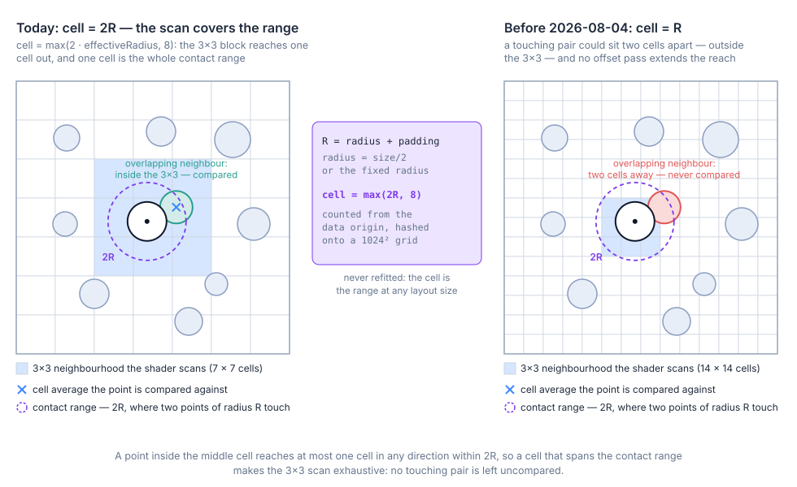
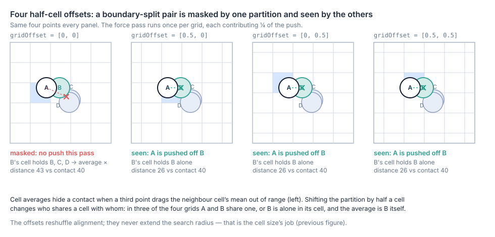
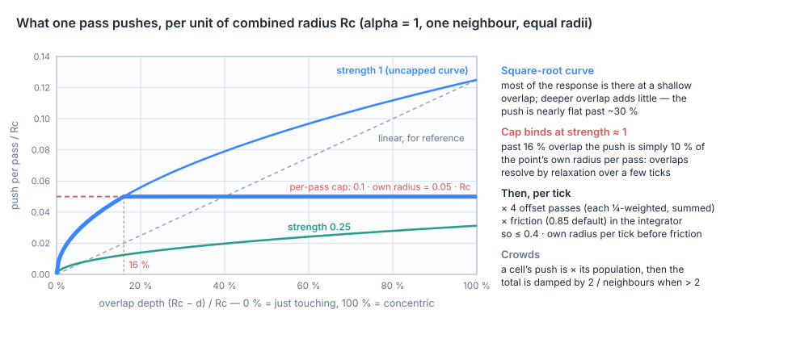
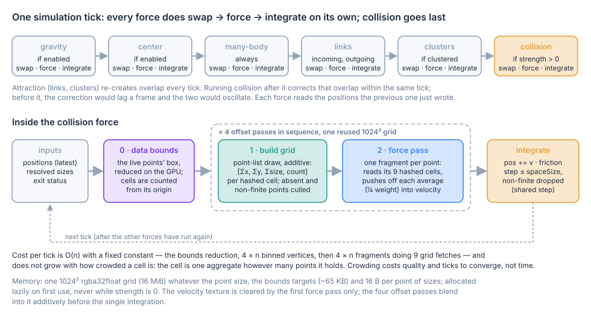

# The collision force: a spatial-hash grid with cell-average contact resolution

This is a walkthrough of the collision force — what it does, how it stays linear-time on
the GPU, and what its approximation costs. It was added in
`feat(simulation): add spatial-hash point collision force` (`68492a9`) and made correct at
every point size in `fix(force): cover the full collision range and unbias cell averages`
(`ca4ee44`) and `fix(force): keep the fitted collision cell at the interaction range`
(`58e2475`); `fix(force): anchor the collision hash to the data — it was inert outside the
space` took the grid off the simulation space, so that collision works wherever a layout
goes once `spaceSize` no longer confines it. The code lives in `src/modules/ForceCollision/`;
the short engineering records are `history/2026/2026-06-13-collision-force.md` and, for the
move off the space, `history/2026/2026-10-14-unbounded-space.md`.

The force is driven by three config keys (interface in `src/config.ts`, defaults in
`src/variables.ts`):

| Property | Meaning | Default |
|---|---|---|
| `simulationCollision` | Strength. `0` disables the force and allocates nothing. | `0` |
| `simulationCollisionRadius` | A fixed collision radius for every point. `0` or `undefined` derive it per point as `size / 2`. | `undefined` |
| `simulationCollisionPadding` | Extra room added to every radius, in space units, so neighbours settle `2 × padding` apart instead of touching. | `0` |

Throughout, **R** means a point's *effective radius*: the fixed radius or half its size, plus
the padding.

## The problem this force solves

The many-body force repels point *centers* with an inverse-distance falloff. It has no idea
how big a point is drawn, so when size carries meaning — degree, a metric, importance — the
biggest points are exactly the ones that end up stacked on each other, illegible and
un-hoverable. What is missing is a **contact force**: one that acts only while two discs
interpenetrate, pushes them apart along the line between their centers, and vanishes the
moment they touch. That is `d3-force`'s `forceCollide`, and cosmos.gl's layout was modeled on
`d3-force`.

Contact is a pairwise question, so computed literally it is n² tests per tick. `d3-force`
avoids that with a quadtree rebuilt on the CPU every tick; cosmos.gl cannot — the whole
simulation has to stay on the GPU at hundreds of thousands of points, and there is no
readback in the loop. The task is to answer "who is touching me?" for every point in a fixed
number of texture reads.

## The idea in one sentence

Bin every point into uniform cells that span the whole contact range, so that each point's
3×3 cell neighbourhood is guaranteed to contain every point it can touch — counting the cells
from the data and hashing them onto a fixed texture, so they follow the layout wherever it is;
then let the point react to the **average** of the other points in each of those nine cells, as
if the cell were one disc of averaged size and position — and do that four times on
half-cell-shifted grids so that a contact split by a cell boundary is caught by one of them.

Four ideas, one per step below: the cell size, the hash that places the cells, the four offset
grids, the averaged contact.

### Step 1 — size the cell to the contact range



`create()` in `src/modules/ForceCollision/index.ts` sizes the cell from the physics, not from
the point count or the layout:

```
R    = (fixed radius > 0 ? fixed radius : maxSize / 2) + padding   // largest R in the graph
cell = max(2 · R, 8)                                                // never refitted
```

The `2 · R` is the whole argument. Two points of the largest radius touch when their centers
are `2R` apart, and the force shader scans only the 3×3 block around a point's own cell — one
cell of separation in each axis. A point inside the middle cell reaches at most one cell in
any direction within a distance of one cell, so **if the cell is at least the contact range,
the 3×3 scan is exhaustive**: no touching pair can sit in cells that are never compared. If
the cell is smaller than that, a touching pair can be two cells apart and no amount of work
downstream can see it.

That is exactly the bug the August fixes closed. The original cell was one `R`, and an
8-unit floor hid it: at the default size of 4 (`R = 2`) the floor made the cell 8, which
happened to span the range, so collision looked fine in every default demo and quietly failed
for anything larger. Measured with collision as the only force, settled: 200 points at size
30 left 79 overlapping pairs, the worst interpenetrating by 24 % of a diameter; 40 points at
size 100 left 18 pairs. Both go to zero with the cell at `2R`. The second fix concerned the
grid's fit to the space: the cell used to be refitted so that a whole number of cells covered
`[0, spaceSize]`, and rounding that count *up* made the cell slightly *smaller* than
requested, while a 32-cell minimum pinned it at `spaceSize / 32` however large the radius grew
— so above `R = 64` the gap reopened completely (30 points at size 300: 26 overlapping pairs,
none once the count rounded down). There is no fit any more: the cells are counted from the
data and hashed onto a fixed grid (step 2), so the cell is the contact range, floored at 8
units, at every radius and every layout size. It is never refitted to the layout: a smaller
cell would leave touching pairs uncompared, and a cell widened to cover more ground turns its
centroid into a wrong push (step 2 measures it).

Two consequences worth holding onto:

- **The cell is sized by the largest point, not by n.** This is the opposite of the many-body
  grid, whose finest level tracks `2·√n`. Bigger points ⇒ bigger cells ⇒ more points per
  cell ⇒ a coarser approximation (step 4). The grid texture is a fixed 1024² whatever the cell;
  how wide a layout it holds without sharing a texel grows with the cell (step 2).
- **The size is a per-graph maximum.** In derived-radius mode, `create()` loops over every
  resolved point size (`getResolvedPointSize`, so a `NaN` "use the default" never poisons the
  maximum, and a spread into `Math.max` never throws on a 50k-element array). One huge point
  coarsens the cells for everybody; a fixed `simulationCollisionRadius` decouples the physics
  from the drawing when that matters.

### Step 2 — count the cells from the data, hash them onto a fixed grid

A cell size alone does not say where the cells are. The grid used to start at world zero and
cover `[0, spaceSize]`, which was safe only while positions were clamped into the space.
Without the clamp, every point outside the space lands in an edge cell — and since the force
compares a point with each neighbouring cell's *centroid*, and pushes only within contact range
of it, a cell holding a whole cluster reports the cluster's own average and never fires. Not
degraded: inert, with nothing on screen to say so. With the clamp deleted and nothing else
changed, an overlapping 800-point cluster of size 12 spread from 120 to 246 units at the centre
of the space, and stayed at 119.7 at 20,000 or −9,000.

So the cells are counted from the data and wrap onto a texture of a fixed size
(`collision-grid.ts`):

- **The origin is this tick's data bounds.** Collision runs its own `DataBounds`, the GPU
  reduction the many-body grid fits itself to
  ([its step 1](../many-body-force/README.md#step-1--fit-the-grid-to-the-data)): collision is
  opt-in and must work with repulsion off, and it runs after the link and cluster sub-steps
  have moved the points, so it reduces the positions it is about to bin. The cells are
  counted from the box's origin and the sums are taken relative to its centre; the cell size
  never derives from the box — it is the contact range, not a fraction of the box. The box is
  floored at the grid's width (`cell × 1024`), which centres a narrower layout in it, so the
  origin follows the layout's centre and holds still while the layout grows or shrinks evenly.
  A box fitted to the points would put the origin on their minimum corner, which moves
  whenever an extreme point does and re-cuts every cell under points that have not moved: on
  the collision stress test that cost 5–9 % more deep overlaps than the old space-anchored
  grid; floored, as few or fewer.
- **The cell is never widened to fit.** The force reads a cell's centroid, which stands in for
  the cell's points only while the cell stays close to the range they collide over. Widening
  it to fit a fixed texel count over the layout was tried, and measured worse than no collision:
  500 overlapping clusters with one point 7,000 units away (a 13.7-unit cell where the cell
  would be 8) ended with 33,621 deep overlaps, from 19,865 at the start. With the cell kept at
  8 units the same scene ends with 6,573, about the 6,548 it reaches without the far point
  (6,166–6,584 at box sizes up to 1e5).
- **So the 1024² grid is a spatial hash.** Cells run unbounded and wrap onto it. A plain modulo
  would hide the same points on every pass and every tick — a point whose texel is shared loses
  its collision for good — and with three blocks of cells in a line would put the centroid of
  the outer two onto the middle one: a phantom neighbour pushing its points the wrong way.
  Instead each axis of a cell is rotated by `r(k) = a·k² + b·k`, `k` the cell's block along the
  *other* axis, with `a` and `b` per offset lattice and a per-tick seed added to `b`. The
  origin's block is not rotated at all, so inside it the hash is a plain grid; the cells that
  share a texel change from pass to pass and from tick to tick, so no point stays hidden; and
  since `r`'s second difference never vanishes, the centroid of two cells symmetric about a
  third lands at least 37 cells from it (for blocks up to 31 apart).

Up to **1,022 cells** wide — 8,176 units at the default point size, whose cell is the 8-unit
floor — a layout shares no texel and bins exactly as on a plain grid: the floored box
centres it in the origin's block. (Only a box stretched by far-flung points can put a narrow
part of a layout across a block corner, where cells of the two diagonal blocks may share
texels.) Wider, cells a grid's width apart share texels. A shared texel's centroid is out of
reach of either cell's points, so it pushes nobody, but its count still adds to the density
damping of the points that scan it (step 4), and resolution slows: Gaussian cluster fields
9,000 to 30,000 units wide keep 10–71 % more overlapping pairs than an unshared 4096² grid
after 600 steps. The rotation is what keeps that a slowdown: 300k points in
1,000 clusters over 9,000 units ended with 477 deep overlaps, against 388 unshared and 52,408
with a plain modulo; and a point midway between two others two grid widths apart is left
alone, where a plain modulo pushed it 5.4 units.

Two details keep the binning identical in both programs, and a third keeps the sums precise.
Both programs that bin a point — the build pass and the force pass — splice in the same code
(`withCollisionGrid`), and like the many-body grid's cell formula it rounds only in a
subtraction and a product, which GLSL ES requires to be correctly rounded: the cell's
reciprocal is taken once on the CPU and passed to both as the same uniform bits. The half-cell
shift of the offset lattices (step 3) is applied after the rounding, in integers — positions
are binned into half cells, and a cell is two of them — because a shift added in world units is
not exact: ANGLE's Metal backend reassociates float arithmetic, and a compiler may fuse
`q · s + ½` into one fma in one program and round it twice in the other. With coordinates
planted within 3 ULPs of half-cell boundaries, −40,000 to 40,000 cells from the origin, both
programs agree on every cell, on Metal and SwiftShader alike. And the grid accumulates
positions relative to the centre of the data box rather than to world zero, so its float sums —
and the centroids taken from them — are as precise wherever the layout sits as around the
origin.

### Step 3 — build the grid, four times

`build-grid.vert` / `build-grid.frag` draw every point as a 1-pixel point into the grid
texture, at the texel its cell hashes to, with additive blending, so each texel accumulates
`[Σx, Σy, Σsize, count]`. Absent points (a `NaN` position, see
`history/2026/2026-06-27-nan-point-removal.md`) are culled here, and so is a present point whose
position is not finite: a `NaN` bins to a `NaN` cell and would poison every sum it touched.

The binning runs **four times**, each on a lattice shifted by half a cell: offsets `[0, 0]`,
`[½, 0]`, `[0, ½]`, `[½, ½]`. The reason is not reach — the offsets never extend the search
radius, which step 1 already settled — but the averaging in step 4:



A point never sees its neighbours individually, only each neighbouring cell's *mean*. When a
touching pair straddles a cell boundary, the neighbour is represented by the mean of its whole
cell, and a third point on the far side of that cell drags the mean out of contact range: the
overlap is real, and this grid cannot see it. Shifting the partition by half a cell changes who
shares a cell with whom. In the figure's shifted grids the pair either lands in one cell — where
the own-cell average, after subtracting yourself, *is* the neighbour — or the neighbour is
alone in its cell, and again the average is exact. The force pass runs once per grid, each pass
weighted by ¼, so a contact that one partition averages away is still resolved by the others —
here by three, at ¾ strength — instead of not at all. That is the likely outcome, not a
guarantee: a pair with enough far-side mass in every partition is masked in all four (see
"What the averaging costs").

The four lattices share **one** 1024² grid texture. Each offset pass rebuilds it and runs its
force pass (step 4) before the next pass rebuilds it on the next lattice; the velocity texture
is cleared by the first force pass only and blended into after, so it sums the four passes'
forces in the same order one pass over four grids would — at a quarter of the memory.

### Step 4 — resolve against the cell averages

`force-collision-spatial.frag` is a full-screen pass, one fragment per point. For each of the
9 cells in the 3×3 block around its own cell it reads the one texel that cell hashes to and
does this (positions, like the grid's sums, relative to the data box's centre):

```
count, Σpos, Σsize ← cell                         // own cell: subtract yourself first,
                                                  //   skip the cell if nobody else is in it
avgPos  = Σpos / count       avgR = (Σsize / count) / 2 + padding
Rc      = R_self + avgR                            // combined radius: contact distance
d       = |pos − avgPos|

if d < Rc:                                        // overlapping the averaged disc
  overlap = (Rc − d) / Rc                          // 0 = touching, 1 = concentric
  push    = alpha · strength · √overlap · Rc / 2 · ¼ · count
  push    = min(push, Rc / 2)                      // per-cell cap
  v      += push · (pos − avgPos) / d              // straight away from the average
```

The **self-subtraction** is the second half of the August fix. The point's own position and
size are in its own cell's sums; leaving them in drags the average toward the point and
halves the measured distance for a two-point cell, so every own-cell overlap was overstated.
Removing them first — and skipping the cell when it then holds nobody — makes the own-cell
average the mean of the *other* occupants, which is what the neighbour cells already were.

The **`count` factor** treats the cell as `count` discs stacked at the average — a crowded
cell pushes harder than a lone neighbour. That would blow up in a dense pile, so after the
loop two normalisations run:

```
if neighbours > 2:  v *= 2 / neighbours            // density damping: ≈ two neighbours' worth
|v| ≤ 0.1 · R_self                                 // per-pass cap
```

Together they mean the count weighting mostly *distributes* the push among the nine cells by
population, while the total stays bounded: a point in a crowd gets roughly two neighbours'
worth of push, aimed away from where the crowd is heaviest.



The **square-root curve** is concave: most of the response is already there at a shallow
overlap and deeper overlap adds little. Combined with the **per-pass cap of 10 % of the
point's own radius**, this is what turns overlap resolution into *relaxation*. At strength 1
with equal radii the cap binds at 16 % overlap — beyond that the point simply moves a tenth of
its radius per pass, up to 40 % of its radius per tick across the four passes, then times the
integrator's friction — so a deep pile unwinds over a few ticks instead of being flung apart
in one and ping-ponging back. Below 16 % the curve tapers the push to zero, so a pair settles
at contact instead of dithering across it. At low strength (the stress test uses 0.25) the cap
never binds and the curve alone shapes the push.

Two more guards, both born from real failure modes:

- **Coincident points get a deterministic fan-out.** If a point sits on a cell's average (two
  points seeded at the same position, or a pile at one spot) there is no direction to push
  along. The shader kicks along an angle of `index × 0.618…` radians — the golden-ratio
  conjugate, so consecutive indices fan out in well-separated directions — with a bounded
  magnitude, and the pile disperses. (The many-body force solves the same problem with a
  per-point random vector; here the index is the only per-point value at hand, and determinism
  is a feature: the same input always unstacks the same way.) "On" means closer than the
  rounding error of the cell's float sums, `d ≤ max(0.001, |Σpos| · 2⁻²³)`: past that the
  direction to the average is noise, and a stack of a few hundred points a thousand units from
  the data's centre read its noise as one common direction and moved as a block.
- **No edge to fall off.** The force pass hashes each of its nine neighbours exactly as the
  build pass hashed every cell, so a point far outside the space scans a full 3×3
  neighbourhood like any other. The space-anchored grid had an edge: both passes clamped cells
  to it, so a point beyond the space at least read the edge cell it had been binned into — the
  cell that, holding a whole cluster, made collision inert out there (step 2).

The output is written into the velocity texture, and the four offset passes blend into it
additively before a single integration.

## Where it sits in the tick



`GraphSimulation.runSimulationStep()` in `src/simulation.ts` (which `Graph` drives) runs the
forces in a fixed order — gravity, center, many-body, links (incoming then outgoing), clusters,
**collision** — and each force is its own `swapFbo() → run() → updatePosition()` triple. There
is no shared velocity sum: every force reads the positions the previous force just wrote,
writes its own velocity texture, and the integrator applies it (`pos += v × friction`) before
the next force runs. The integrator bounds a step's length, not where it lands: a non-finite
step is dropped, one longer than `spaceSize` is shortened to it, and nothing holds a point
inside the space — which is why collision has to work wherever the points are (step 2).

Collision is deliberately **last**. Link springs and cluster attraction re-create overlap on
every tick; running collision after them corrects that overlap within the same tick. Running it
before them would leave the attraction's overlap standing until the next frame, and the two
would settle into a standing oscillation.

The force is **lazy and zero-cost when off**. `isForceCollisionReady` in `src/simulation.ts`
is the whole state machine: the grid texture, the data-bounds targets, the size texture and
both programs are allocated the first time collision actually runs, so a graph that never sets
`simulationCollision > 0` pays no memory and no compile. Anything that changes the inputs flips
the flag back and the next collision tick rebuilds:

| Change | Why it invalidates |
|---|---|
| point positions, sizes, or many-body data (`applyDataUpdates`) | the size texture mirrors the point count and resolved sizes |
| `simulationCollisionRadius`, `simulationCollisionPadding` | the cell size is derived from `R` |
| `pointDefaultSize` in derived-radius mode | `R` comes from sizes, and the default is one of them |

`spaceSize` is not in the table: nothing in the force depends on it. The grid is a fixed size,
and where its cells fall is recomputed from the data every tick.

Changing `simulationCollision` itself needs no rebuild — strength is a uniform read every
tick — so it can be animated freely, including to `0` and back.

## What it costs

**Time is O(n) with a fixed constant, independent of density.** A tick is the data-bounds
reduction, then four point-list draws of n vertices (the binning) and four full-screen passes
of one fragment per point, each doing nine grid fetches plus its own position and size. How
many points share a cell does not change that: a cell is one texel however crowded it is. Crowding costs *quality* — the
average stands in for more individuals — and *ticks to converge*, not time per tick. The
**Performance → Collision (50k points)** story is the worst case: 50,000 sized points seeded
in a dense disc with repulsion off and a gentle gravity holding them packed, so collision has
to keep resolving overlap every tick, with the FPS monitor on. All told — reduction, hash and all —
collision costs a fixed ~0.3 ms per step more than the space-anchored grid it replaced, on an
M3 Max: 9–13 % of a step at 5k–20k points, 2–3 % at 100k, and over half for a few hundred
points, whose step costs little else.

**Memory** is one 1024² `rgba32float` grid texture, 16 MiB whatever the point size (the four
512² grids the default point size used to get came to the same; bigger points got a coarser
grid and less), plus the data-bounds reduction's small targets (~65 KB) and a size texture of
16 bytes per point. None of it exists until the force first runs.

## What the averaging costs

The force is cheap because it never looks at an individual neighbour. That is also the source
of everything it gets wrong:

- **Masked contacts.** A neighbour cell's mean can sit outside contact range while one of its
  members is overlapping you (the figure in step 3). The four offsets make this unlikely, not
  impossible — a pair surrounded by enough far-side mass in every partition is missed in all
  four.
- **Phantom pushes.** Conversely, a cell's mean can sit *inside* contact range while no
  individual member touches you — two points flanking you on either side average to your own
  position's neighbourhood — and you are pushed off a disc that isn't there.
- **Shared texels past 1,022 cells.** A layout wider than the hash's alias-free span
  has cells sharing texels (step 2). A shared texel's centroid is out of reach of both cells'
  points, so it pushes no one, and the rotation moves the sharing from pass to pass and tick to
  tick, so no point is hidden for good — but each shared texel is a pass without collision for
  the points in it. Wide layouts resolve slower, and one that occupies a fair fraction of the
  grid's million texels shares on every pass: a million points spread evenly over a square two
  grid widths wide went from 376k overlapping pairs to 827 in 200 steps, against 121 unshared.
- **Radial only.** Every push points straight away from an average, the same limitation the
  old many-body near field had. Collision gets away with it because it is a local contact
  force stacked on top of the many-body repulsion, which now supplies the tangential mixing
  (`docs/many-body-force/README.md`); on its own, collision would flatten a pile before it
  spread it.
- **Residual jitter in dense regions.** The same point sees four different averages per tick
  and a different neighbourhood next tick as things move; in a cell far above one occupant the
  four pushes do not agree, and the per-pass cap turns that disagreement into a small dither
  rather than a fling.
- **It fades with alpha.** Like every cosmos.gl force the push is scaled by `alpha`, so as the
  simulation cools the correction shrinks to nothing, and an overlap that was still relaxing
  when alpha hit its floor stays. `simulationDecay` is roughly the number of ticks until that
  floor; both collision stories set it to `100000` so the layout keeps resolving for as long as
  anyone watches. (`d3-force`'s `forceCollide` ignores alpha altogether.)

For scale: the many-body force's near field started with this exact centroid approximation and
replaced it with unbiased sampled pairs when the radial-only artifact became visible on dense
hubs. Collision has not needed that step yet — its role is to *finish* a layout other forces
have shaped, not to shape it — and the obvious upgrade if it ever does is already in the
codebase: the depth-peeled per-cell slot lists the many-body force builds would give collision
real neighbours to test against instead of one mean.

## Not a `d3-force` clone

| | `d3-force` `forceCollide` | cosmos.gl collision |
|---|---|---|
| neighbour search | quadtree, exact pairs, CPU | spatial hash of uniform cells, cell averages, GPU |
| per-tick cost | typically O(n log n) plus `iterations` sweeps | O(n) fixed: a bounds reduction, then 4 draws + 4 passes |
| response | linear in overlap, split between the pair by `r²` (a small disc yields to a big one) | `√overlap`, symmetric before caps; caps scale with each point's own radius |
| overlap depth handled per tick | full, over `iterations` (default 1) | relaxation: ≤ 0.4 × own radius per tick |
| coincident points | random jiggle | deterministic golden-angle fan-out by index |
| `alpha` | ignored | scales the push; cools with the layout |
| dense clusters | exact, slower | damped to ≈ two neighbours' worth, constant time |

## Tuning guidance

- **Link distance must clear the radii.** If `simulationLinkDistance` is smaller than the
  combined radii of two linked points, the spring pulls them inside each other every tick and
  a capped relaxation force cannot win — you get an unresolvable pile. The **Forces →
  Collision** story sizes points up to ~33 and uses `linkDistance: 50`.
- **Strength ~1 is a rate, not a stiffness.** At 1 the per-pass cap takes over past 16 %
  overlap, so a point moves at most 10 % of its radius per pass however much deeper the
  overlap is; at 0.5 the cap only binds past 64 %, and below 0.4 it never does — the curve
  alone shapes the push (the stress test's 0.25 is in that regime).
- **Padding is the knob for breathing room.** It composes with both radius modes and enters
  the cell size, so raising it a lot coarsens the cells; a couple of units is typical.
- **A fixed radius decouples physics from drawing.** Useful when one giant point would
  otherwise dictate the cell size for everyone, or when the visual size animates but the layout
  should not.
- **Give it time.** Because the push is alpha-scaled and capped, a slow decay
  (`simulationDecay` in the tens of thousands) and moderate friction (0.85) let deep overlaps
  finish relaxing before the layout freezes.

## Glossary

- **Spatial hash** — a uniform grid used as a lookup structure: a point's cell is a pure
  function of its position (`⌊(p − origin) / cell⌋`), so neighbours are found by looking at
  adjacent cells rather than by walking a tree. Here the cells are counted from the data's
  origin without bound and wrap onto a fixed 1024² texture, each axis rotated by the cell's
  block along the other axis; the "hash" is the texel a cell lands on.
- **Data bounds** — the live points' bounding box, reduced on the GPU every tick
  (`src/modules/Shared/data-bounds.ts`); collision counts its cells from the box's origin and
  takes its sums relative to the box's centre, but never derives its cell size from it.
- **Contact range** — the center distance at which two discs touch, `R₁ + R₂`; `2R` for the
  largest radius, and the reason the cell is `2R` (floored at 8 units).
- **Cell average** — a cell's `Σ / count`; the one averaged disc the point reacts to in place
  of that cell's individual members.
- **Offset (staggered) grids** — the same grid shifted by a fraction of a cell; averaging
  over several partitions removes the dependence on where the boundaries happened to fall.
- **Relaxation** — resolving a constraint by repeated small, bounded corrections rather than
  one exact solve; the per-pass cap makes collision a relaxation.
- **Alpha** — the simulation's global cooling factor, from 1 at start to `ALPHA_MIN`
  (`0.001`) when it stops; every force, collision included, is proportional to it.

Regenerate the figures with `node gen-diagrams.mjs` from this folder. The grid panels bin
points with the same rules as the shaders and assert the story they tell, so keep the
script's constants in sync with `src/modules/ForceCollision/index.ts` and `collision-grid.ts`
when the algorithm changes.
