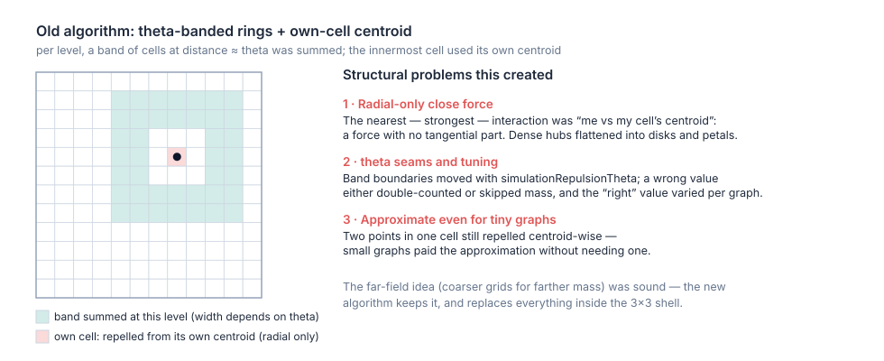
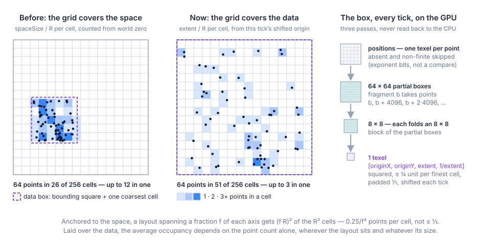
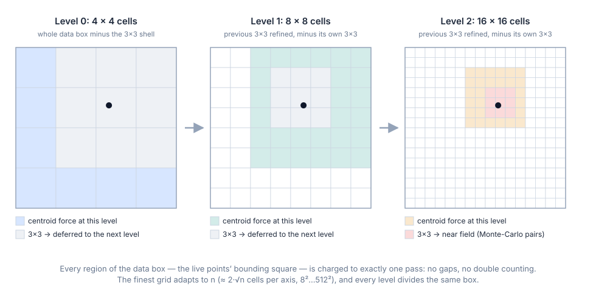
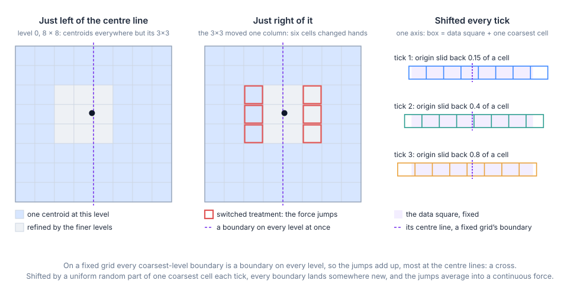
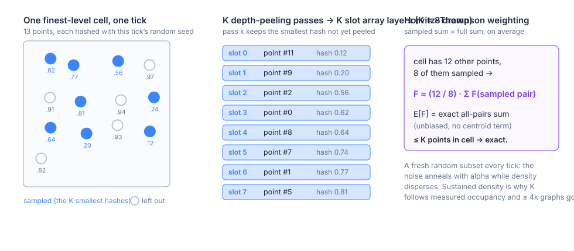
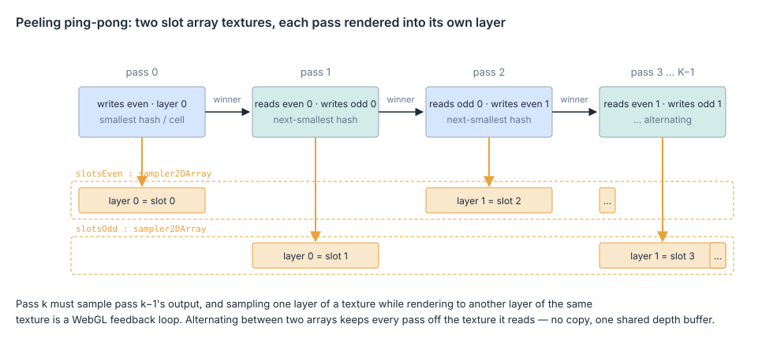
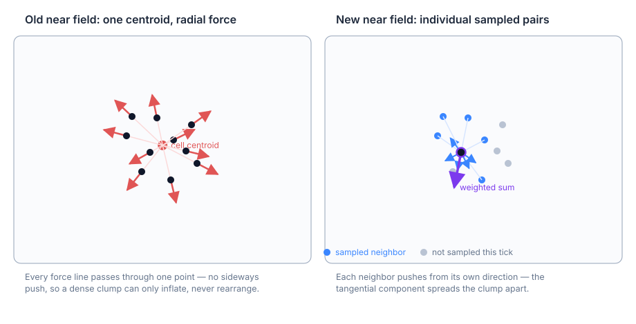
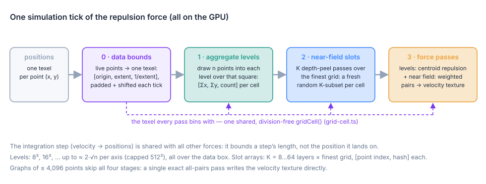
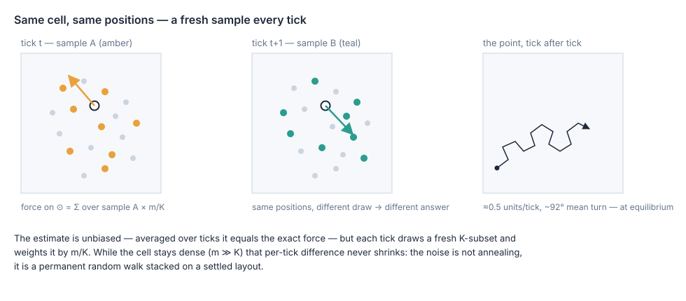
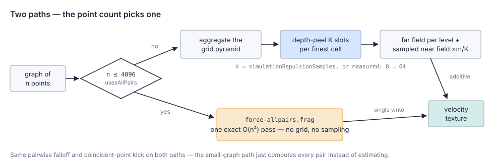

# The many-body repulsion algorithm: grid pyramid + Monte-Carlo near field

This is a walkthrough of the repulsion force introduced in
[#240](https://github.com/cosmosgl/graph/pull/240) — what the old algorithm did, what the new
one does instead, and why the change matters. The code lives in
`src/modules/ForceManyBody/`; the short engineering records are
`history/2026/2026-07-08-many-body-repulsion.md` and (for the sampling-noise follow-up
described near the end) `history/2026/2026-08-14-nearfield-jitter.md`.

Since that follow-up the force has **two paths**: graphs of at most 4,096 points are computed
**exactly** — one all-pairs pass, no grid, no sampling (`force-allpairs.frag`, see
[Small graphs are exact](#small-graphs-are-exact-the-all-pairs-path)) — and everything below
describes the grid + Monte-Carlo machinery that larger graphs use.

The problem-and-fix story behind that follow-up — the measurements, the captured trajectories,
and its own figures — is also a standalone page: [`jitter-fix.html`](./jitter-fix.html)
(self-contained; open it locally in a browser — GitHub shows only its source).

The grid has since stopped being nailed to the simulation space, too. Its *resolution* has
followed the point count since #240, but until the grid was made to follow the data — part
of the work that stopped `spaceSize` bounding a layout — its *placement* was
`[0, spaceSize]`. Every level now divides the bounding square of the live points, recomputed
on the GPU every tick and shifted by a random part of a cell so that no cell boundary stays
put — see [step 1](#step-1--fit-the-grid-to-the-data),
[why the grid shifts every tick](#exactly-once-is-not-continuous-why-the-grid-shifts-every-tick),
and [The grid follows the data](#the-grid-follows-the-data-not-the-space) for what the old
placement cost (engineering records: `history/2026/2026-10-14-unbounded-space.md` and
`history/2026/2026-10-15-many-body-grid-seams.md`).

## The problem both algorithms solve

Repulsion is an *n-body* force: every point pushes away every other point. Computed literally
that is n² pairs — at 100 000 points, ten billion pair evaluations *per simulation tick*. No
GPU does that at 60 fps, so every practical layout engine approximates: **distant mass may be
lumped together, close mass may not.** A point cares whether its neighbor is 3 or 5 units away;
it does not care whether a blob on the far side of the graph is at 4000 or 4002.

Both the old and the new algorithm follow that principle. They differ in *how* they lump the
far mass, and — decisively — in what they do up close.

## How the old algorithm worked



The old code (`force-centermass.frag` + the old `force-level.frag`, still visible on `main`)
built a stack of grids over the space, each holding per-cell aggregates
`[Σx, Σy, count]` — a cell's **centroid** (center of mass) is `Σ/count`. Then, per point:

1. **Far field:** at each level, a *band* of cells — a ring whose width and position depended
   on the `simulationRepulsionTheta` parameter — was summed centroid-wise. Coarser levels
   handled farther rings.
2. **Near field:** at the deepest level, the point was repelled from **its own cell's
   centroid** — one force, from one averaged position.

This worked, but had three structural problems:

1. **The close force was purely radial.** The strongest interactions a point has are with its
   nearest neighbors, and the old code compressed all of them into a single centroid. A force
   from a centroid always points along the line through the centroid — there is *no tangential
   component*. A dense clump can inflate, but its points can never slide sideways past each
   other to rearrange. That is exactly the artifact you could see on dense hubs: they collapsed
   into flat disks and petal shapes instead of spreading into clouds.
2. **`theta` was a footgun.** The band boundaries moved with `simulationRepulsionTheta`. A
   wrong value either double-counted mass (over-repulsion) or skipped mass (holes in the
   force), and the right value depended on the graph. Users had to tune a parameter that only
   existed to patch the approximation's seams.
3. **Small graphs paid for an approximation they didn't need.** Two points sharing a cell
   repelled each other centroid-wise even when the whole graph had 500 points and exact forces
   would have been trivial.

## The new algorithm in one sentence

Keep the sound part — **coarser grids for farther mass** — but make the decomposition cover
every cell exactly once (no `theta`), and replace the centroid near field with an **unbiased
random sample of real pairwise forces**, so close points repel each other *individually*.

The scheme is known in physics simulation as **P3M** (particle–particle / particle–mesh): a
mesh handles the far field, true particle–particle forces handle the near field. The same idea
already powers the 3D force on the `feat/3d` branch; #240 ports it back to 2D.

### Step 1 — fit the grid to the data



Every level of the pyramid divides one square, and that square is the **bounding box of the
live points**, recomputed on the GPU every tick before anything is binned (`DataBounds`,
`src/modules/Shared/data-bounds.ts`). It used to be the simulation space, `[0, spaceSize]`: a
layout covering part of the space got only the cells over that part, and points outside the
space were filed into its edge cells. Fitted to the data, the grid's resolution is a property of
the point set alone — wherever the layout sits and however much of the space it covers.

The box is a reduction in three full-screen passes, and it never comes back to the CPU — a
readback would stall the pipeline every tick, so every pass that needs it reads it as a texture:

1. **64 × 64 partial boxes up to 262,144 points, 128 × 128 above**
   (`reduce-bounds-buckets.frag`). Fragment *b* of *G*² strides through the point list —
   points *b*, *b* + *G*², *b* + 2·*G*², … — so the work splits evenly however the points sit in
   the texture or in space. That scan is the only part of the reduction that grows with the
   graph: at 64² a million points is ~245 per fragment and the reduction took 0.58 ms on an
   M3 Max, at 128² it is ~61 and 0.22 ms (2M: 1.28 → 0.45 ms). The grid is chosen per run from
   the point count (`getBucketGridSize`: the power of two giving about 64 points per fragment,
   between 64 and 128), so graphs up to 262,144 points run exactly as before.
2. **8 × 8 or 16 × 16** (`reduce-bounds-blocks.frag`): each fragment folds an 8 × 8 block of
   those. Without this middle pass the last fragment folded all 4,096 partial boxes in
   sequence — ~0.75 ms per tick, 11 % of a 100k-point step on an M3 Max. With it, the whole
   reduction costs ~0.16 ms up to 300k points.
3. **One texel** (`reduce-bounds-final.frag`): `[originX, originY, extent, 1 / extent]`. Its
   texture is the same object for the instance's life; only the first two targets are resized
   when the point count crosses the threshold. Min and max are exact, so either grid publishes
   the same box bit for bit.

What goes into that texel:

- **Only live, finite positions.** Absent points (`exit.g > 0.5`) and non-finite positions are
  skipped. The whole grid derives from this box, so one diverged point would otherwise set the
  cell size for every other point. The test reads the exponent bits rather than comparing: a
  compiler allowed to assume no NaNs may fold a comparison away.
- **A square around the data's centre.** The levels are square and halve exactly; a
  non-square box would give non-square cells. Its side is the larger of the two spans.
- **A one-cell margin, at a random place every tick.** The fitted square is padded by one cell
  of the coarsest level, a seventh of its side, and its origin slides back by a uniform random
  part of that cell on each axis, drawn fresh every tick (`originShift`). The data stays inside
  whatever the draw, since the padding is exactly the slide's range. Without the shift the
  grid's cell boundaries sit on fixed lines, and dense layouts draw them — see
  [why the grid shifts every tick](#exactly-once-is-not-continuous-why-the-grid-shifts-every-tick).
  A margin costs accuracy at the layout's edge, which then falls mid-cell: a fixed one was
  rejected for exactly that (0.124 % error instead of 0.060 % on a square layout, 0.31 % instead
  of 0.23 % on a disk). This one costs a little accuracy too, but less than that margin did,
  because the pyramid now starts at 8² (step 2): against the same pyramid on a fixed box, the
  error of the 20-tick-mean force rises from 0.055 % to 0.066 % on a square and from 0.093 % to
  0.098 % on a disk, and a single tick's error is 0.091 % and 0.118 % (100k points, against an
  exact all-pairs sum). What it buys is the seams' removal.
- **A floor of ¼ unit per finest cell** (`MIN_FINEST_CELL_SIZE`; the fitted extent is at least
  0.25 × the finest grid size, before the margin). One point, or a stack of coincident points,
  is a legitimate layout with a zero-size box, and the grid still needs a non-zero cell to
  index. A quarter of the kernel's `distanceMin` — the 1-unit scale where its falloff softens —
  so the floor binds only once the points' mean spacing drops below about a unit, where the
  kernel has softened already. At one unit per cell it bound on an ordinary 100k-point square a
  tenth of the space wide (mean spacing 1.3 units) and raised its error from 0.06 % to 0.30 %.

**One cell formula, spliced into four shaders.** Four programs bin a point: the aggregation
(`calculate-level.vert`), the per-level far field (`force-level.frag`), the near-field peel
(`build-nearfield-slots.vert`) and the near-field force (`force-nearfield.frag`). The pyramid
charges every point to exactly one pass (step 3) only while they agree cell for cell — a point
binned into one cell by the aggregation and looked up in its neighbour by a force pass is
counted twice or not at all. So the formula lives once, in `grid-cell.ts`, and `withGridCell`
splices it into all four at a `// @grid-cell` marker:

```glsl
vec4 dataBox = texelFetch(dataBoundsTexture, ivec2(0), 0); // [originX, originY, extent, 1/extent]
float cellsPerUnit = dataBox.w * cellsPerAxis;             // × a power of two: exact
ivec2 cell = clamp(ivec2(floor((worldPosition - dataBox.xy) * cellsPerUnit)), ivec2(0), lastCell);
```

It is division-free on purpose. The four are separate programs, two vertex and two fragment,
and GLSL ES allows a highp division to be off by 2.5 ULP, so a quotient could round differently
from one program to the next and put a point sitting right on a cell boundary in different
cells. A subtraction and a multiplication must be correctly rounded, so every program gets the
same bits; the one inexact step, the extent's reciprocal, is taken once by the reduction and
shared through the texel. Scaling it by the level's power-of-two cell count changes only the
exponent, so a point's offset from the origin on level L + 1 is exactly twice its offset on
level L, and its cell there is `2·cell` or `2·cell + 1` on each axis — the parent–child relation
the child-block refinement in step 3 relies on, which the edge clamp preserves. `withGridCell` also
throws if a host shader's uniform `#define` would rewrite one of the formula's identifiers, a
mistake that otherwise surfaces as a compile error far from its cause, or not at all.

### Step 2 — aggregate the grid pyramid

A pyramid of grids at 8², 16², 32², … resolution, up to an adaptive finest level of about
**2·√n cells per axis** (floored at 8², capped at 512²), every one of them over the data box
from step 1. Each tick, every point is drawn into each grid as a 1-pixel point with additive
blending, accumulating `[Σx, Σy, count]` per cell (`calculate-level.vert/frag`).

The pyramid used to start at 4²; it now starts at `COARSEST_GRID_SIZE` = 8 (`index.ts`). The
4² level was the slowest pass, most likely from blending contention, with about a sixteenth of
all points landing on each of its texels, and the least accurate, each centroid standing in
for a sixteenth of the layout. Starting at 8² took a third off the step at 100k–300k points
(6.9 → 4.6 ms and 19.3 → 12.4 ms on an M3 Max) and cut the error on a 100k-point disk from
0.22 % to 0.09 %. It also keeps step 1's margin at a seventh of the box instead of a third.

The 2·√n target means an *average of at most ¼ point per finest cell* of the box, and at most
⅓ over the data's own square, which spans 7/8 of each axis — most cells are empty or hold one
point (past the 512² cap the average climbs: at 100k points, 0.38 per cell of the box and 0.50
over the data).
Because the grid follows the data, that holds wherever the layout sits and however far gravity
has pulled it in; on a grid fixed to the space it held only for a layout that filled the space.
Keep that in mind for step 4.

### Step 3 — the pyramid tiles the data box exactly once



The `theta` bands are gone. Instead there is one fixed, resolution-independent rule
(`force-level.frag`):

- The **coarsest level** applies centroid repulsion from *every* cell except a **shell**
  around the point's cell: the 5×5 block of cells within Chebyshev distance 2.
- Each **finer level** takes over exactly that deferred shell — which at double resolution is
  its aligned **10×10 child block** — and applies centroid forces there, again minus its *own*
  shell. Every level but the finest leaves a 5×5 shell; the finest leaves 3×3
  (`getShellRadius` in `index.ts`), so the last level refines the 10×10 block minus its 3×3.
- After the finest level, the only region not yet accounted for is the finest 3×3 neighborhood.
  That is the **near field**, and it is the only part where the centroid trick would do damage
  (up close, direction errors matter). It gets step 4 instead.

Every cell of the box is charged to exactly one pass, and every live point lies in the box:
**no gaps, no double counting, nothing to tune.** Far-field centroid error is small by
construction, because above the finest level a cell is only ever used from at least two cells
away, where a centroid's error is about a quarter of what it is from one cell away; and the
finest level's cells hold about one point each (step 2), so their centroids are the points
themselves. The 5×5 shell is what clustered data needs: a coarse cell there holds much of a
cluster or splits one, and its centroid stands for very uneven mass. With the 3×3 shell on
every level and the grid shifting every tick (next), that error reached every point as
visible jitter in a clustered layout (25 clusters of 900 points at repulsion 8), where a
uniform 300k blob stayed calm. Measured as RMS displacement per tick at alpha 1 on that layout,
in point spacings: `main` 0.0137, the 3×3 shell with the shift 0.0181, the 5×5 shell 0.0082.
Widening only the coarsest one, two or four levels gave 0.0100, 0.0101 and 0.0090 but still
rippled to the eye — a jump at a fine-level boundary moves a whole line of points together, and
the eye picks that out well below what the RMS says. The wider shell costs the far-field passes
about 2.3× the texel reads (coarsest level 55 → 39, each middle level 27 → 75, finest 27 → 91,
217 → 505 over seven levels); the aggregation and the near field are unchanged. In the
**Performance → Repulsion Benchmark** story (Chrome, Apple Silicon) that is +2 % at 20k points
and +33–38 % from 50k to 200k (4.33 → 5.87 ms, 7.14 → 9.83 ms, 13.88 → 18.48 ms per step); 2k
and 5k points run the all-pairs path and are unchanged. Small, but not continuous — next.

### Exactly once is not continuous: why the grid shifts every tick



Exactly-once coverage says every cell is charged to one pass. It says nothing about what
happens when a *point* moves. Each level picks the cells it takes as centroids from the
point's own cell, so a point that crosses a cell boundary carries its shell with it:
one column of cells switches from "one centroid" to "refined by the finer levels", and the
column on the other side switches back. The two treatments approximate the same mass
slightly differently, so the force **jumps** at every cell boundary of every level.

Each jump is small. On a fixed grid it is also always in the same place, and every boundary
of the coarsest level is a boundary on *every* finer level too, so the jumps along it add up.
From a 4² start those are the data box's centre and quarter lines, and the centre lines dip
deepest: a crossing there switches a column of coarsest cells on both sides, while at a
quarter line the shell is clipped by the box's edge and only one column switches. In a
dense layout the force near a centre line points away from it on both sides, and points
drift off the line until the layout shows a **cross**: a thin, emptier line along each
centre line, and fainter ones on the quarter lines. The space-anchored grid on `main` drew
the same cross along the centre lines of the space.

So the grid moves. Every tick the data box is padded by one cell of the coarsest level (a
seventh of its side) and its origin slides back by a uniform random part of that cell on
each axis (`DataBounds`' `originShift`, drawn from the simulation's random stream, which
`randomSeed` seeds when set).
The padding is exactly the slide's range, so the data stays inside the box whatever the
draw. A uniform shift over one coarsest cell is uniform modulo every finer cell too, so
every level's boundaries spread evenly over the data from tick to tick, and the jumps
average into a continuous force. What remains is per-tick noise that alpha anneals, the
same trade the near field makes in step 4.

Measured on the real GPU (300k points, gravity 0.25, 1,500 ticks), with the 3×3 shell on every
level — before the 5×5 shell above the finest level, which has not been re-measured here: the
point density in a thin strip on a line, divided by the density around it (1.0 = no seam).

| | centre lines | quarter lines | off-boundary lines |
|---|---|---|---|
| `main`, grid on the space (`spaceSize` 8192) | 0.79 | 1.00 | 1.00 |
| grid on the data, fixed, 4² start | 0.87 | 0.97 | 1.00 |
| grid on the data, fixed, 8² start | 0.99 | 0.98 | 1.00 |
| grid on the data, shifted every tick, 8² start | 1.01 | 1.00 | 1.00 |

`main`, the 4²-start row and the shifted row are two seeds at `spaceSize` 8192; the 8²-start
fixed row is four seeds at `spaceSize` 4096. Standard errors are 0.002–0.006.

Starting the pyramid at 8² (step 2) weakens the cross on its own, since each switched cell holds
a quarter of the mass a 4² cell did, but it leaves 1–2 % dips along every 8² boundary. The
shift removes them. It pads by one *coarsest* cell, which is the other reason for the 8² start:
from 4², the padding would be a third of the box and would coarsen every level by as much.

### Step 4 — the Monte-Carlo near field

This is the heart of the change. The exact near-field force on a point is the sum of pairwise
forces from every other point in the 3×3 finest-cell neighborhood. Computing all of them is
O(occupancy²) per point — fine for sparse cells, fatal for a 1000-point hub cell. The new code
computes an **unbiased estimate** instead:



**Sampling (`build-nearfield-slots.vert`):** every tick, each point gets a fresh pseudo-random
hash. K "depth peeling" passes then run over the finest grid; pass *k* selects, per cell,
the point with the smallest hash *not yet selected by passes 0..k−1* (the GPU depth test does
the per-cell minimum for free). After K passes, the K layers of a **slot array texture**
(`sampler2DArray`, one layer per pass) hold a uniform random K-subset of each cell's points —
re-drawn from scratch every tick.

**K adapts to the graph size** (`getNearFieldSlotCount` in `index.ts`): 32 slots up to 16k
points, 16 up to 65k, 8 above. Peeling is inherently sequential — one render pass per slot —
so K is a direct trade between per-tick cost and sampling variance; big graphs keep the cheap
estimator (per-point noise is sub-pixel at that scale), smaller ones buy more slots so that
realistic hub-cell occupancies are covered exactly. Each pass ping-pongs between two plain 2D
targets (pass *k* must sample pass *k−1*'s output, and sampling one layer of a texture while
rendering to another layer of the same texture is a WebGL feedback loop) and its result is
copied into its array layer.



**The hash must be an integer hash.** The first version used the classic
`fract(sin(index * 12.9898 + seed * 78.233) * 43758.5453)` one-liner, which is quietly broken at
this engine's scale: with hundreds of thousands of points the `sin()` argument reaches millions
of radians, where GLSL guarantees no accuracy and real GPUs diverge — [testing across
vendors](https://github.com/danilw/GPU-sin-hash-stability) shows sin-hashes produce different
(and sometimes visibly broken) values on NVIDIA vs AMD vs Apple vs mobile. Degraded precision
means correlated or *colliding* hashes, and a collision is not cosmetic here: the peeling
eligibility test (`hash <= previous slot's hash`) silently skips a tied point, so it can never
be sampled and the Horvitz–Thompson estimate loses its unbiasedness. The replacement is
**lowbias32**, an XOR-shift–multiply integer hash that sits on the quality/speed Pareto
frontier of [Jarzynski & Olano's GPU-hash study
(JCGT 2020)](https://www.jcgt.org/published/0009/03/02/paper.pdf) with the [lowest measured
bias of its class](https://fgarlin.com/blog/gpu-rng/). Integer ops are exact on every GPU, and
both inputs are exact (the point index is an integer-valued float; the per-tick seed enters via
`floatBitsToUint`), so the ordering is identical across platforms. Only the hash's top 24 bits
become the float ticket, so the value written to the slot texture round-trips bit-exactly into
the next pass's comparison. Cost is a wash: ~8 integer ALU ops replace a special-function-unit
`sin()`, in a pass dominated by texture fetches anyway.

**Estimation (`force-nearfield.frag`):** for each of the 9 neighborhood cells, the point sums
the true pairwise forces from the sampled slots (skipping itself), then scales the sum by

```
others / sampled        // e.g. cell holds 48 other points, 32 sampled → × 48/32
```

This is the **Horvitz–Thompson estimator**: since each of the cell's `others` points had equal
probability `sampled/others` of being in the sample, dividing by that probability makes the
*expected value* of the estimate equal the exact all-pairs sum. Unbiased — and with **no
centroid term**, so the tangential force component survives:



Two properties fall out for free:

- **Sparse cells are exact.** A cell with ≤ K points is sampled exhaustively
  (`others == sampled`, weight = 1). With the finest grid at 2·√n per axis over the data box,
  the average cell over the data holds at most ⅓ point (step 2) — so for typical graphs the near
  field *is* the exact all-pairs force, and the approximation only kicks in inside genuinely
  dense hubs.
- **The sampling noise is (mostly) a feature.** The estimate is unbiased but noisy, and the
  noise is re-rolled every tick. Because every force is scaled by `alpha`, the noise *anneals*:
  large early, when clumps need breaking apart, shrinking to nothing as the layout settles. It
  is precisely the jitter that lets stacked points find distinct directions to escape along.
  The caveat — and what the 2026-08-14 follow-up fixed — is layouts where the density never
  disperses: see [When the noise stops annealing](#when-the-noise-stops-annealing) below.

### Step 5 — two stability guards

Both live in `force-nearfield.frag`, both born from real failure modes:

- **Coincident points get a random kick.** Two points at *exactly* the same position have no
  separation direction — an inverse-distance force is undefined, so they would stay stacked
  forever, while their combined cell count repels everything else away, carving an empty "void
  ring" around the stack. Instead, each point kicks along its own per-point random vector, so a
  pile disperses.
- **Per-tick kick bound (a fixed length).** The `others/sampled` weight is unbiased but
  high-variance: in a cell holding far more points than sampling slots, a couple of very close
  samples can be multiplied into a huge one-tick kick — flinging points across the screen at
  startup and ejecting points from dense cluster centers. The bound caps the magnitude and
  keeps the direction; genuine spreading kicks are far below it, and bulk expansion is driven
  by the far-field levels anyway. It is `2 × spaceSize / finest grid size` (`getMaxStep` in
  `index.ts`): twice the finest cell the grid had when it covered the space, at this point
  count. It is deliberately *not* twice the grid's
  actual cell: the grid follows the data, and a cell-relative bound would tighten as a layout
  contracts — throttling the kicks that break dense clumps apart exactly when they are needed.
  The all-pairs path bounds with the same helper, so the dynamics stay continuous across the
  4,096-point threshold.

### The per-tick pipeline



Orchestrated by `src/modules/ForceManyBody/index.ts`:
`drawBounds()` → `drawLevels()` → `drawNearFieldSlots()` → `drawForces()` (per-level force
passes plus the near-field pass, all blending additively into the shared velocity texture). The
bounds come first, once per tick, because every later pass must bin against the same box, this
tick's shift included: the
aggregation and the forces binning against different boxes would break the exactly-once
coverage. Integration into positions is the same step every other force uses; it bounds a
step's length, not where the step lands — a non-finite step is dropped, one longer than
`spaceSize` is shortened to it, and nothing holds a point inside the space. Small graphs replace
all four with a single `drawAllPairsForce()` pass — next section.

## When the noise stops annealing

The "noise is a feature" argument has a hole, found the hard way on a real graph (the
163-country border-adjacency network): it assumes the density that causes the sampling
variance *disperses*. Under pure repulsion it does — the clump expands, occupancy falls to ~K
within a second, and the noise dies with it, sub-pixel before anyone sees it. But when link
attraction or gravity holds a hub together *while alpha stays high* (a long-running layout, a
reheated one, `start()` on interaction), occupancy stays far above the slot count forever, and
the per-tick re-drawn sample turns into visible, permanent shimmer: measured on that country
graph, every point wandered ~0.5 units per tick with a ~92° mean direction change — a pure
random walk stacked on a settled layout, while an exact all-pairs reference under the same
integration was three orders of magnitude stiller.



Two changes closed it (2026-08-14):

1. **Small graphs skip the estimator entirely** — the all-pairs path below. This is the case
   where sustained dense hubs are both most common and cheapest to compute exactly.
2. **K became adaptive** (32/16/8 — see step 4). Mid-size graphs get 2–4× more samples, which
   both extends the exactly-covered occupancy range and shrinks the residual variance
   (amplitude ∝ occupancy/K · 1/√K) — while the ≥ 65k tier keeps today's 8-slot cost
   unchanged.

The **Performance → Repulsion Jitter: Fixed vs Before** story shows this live: the real
graph that surfaced it, run side by side — today's exact path next to the pre-fix sampled
configuration (forced back on through a story-only internals patch) — each with alpha held
at 1, a sliding-window step/turn meter, and a trajectory trace of one dense-cell point.

## Small graphs are exact: the all-pairs path

At or below **4,096 points** (`ALL_PAIRS_MAX_POINTS`) the force runs as one full-screen pass
(`force-allpairs.frag`): each point loops over every other point and sums the same clamped
inverse-distance pairwise force the grid path uses, with the same coincident-point random
kick. No pyramid, no peeling, no sampling — the result is exact at *any* cell occupancy, so
there is no noise to anneal and nothing to shimmer. The two paths also bound the same thing:
pairs within the near-field scale (the grid path's fixed kick bound, `getMaxStep`,
`2 × spaceSize / finest grid size`) are jittered and capped like the near-field pass's
sum, so a coincident stack expands instead of teleporting, while farther pairs pass through
unbounded like the level passes. Having no grid, this path never needed the data bounds.



It is also simply faster there. Depth peeling costs one render pass per slot, ~0.1 ms of
fixed overhead each; at 2k points, 64 experimental slots measured ~6.4 ms/step while the
single all-pairs pass measures **~1.8 ms/step** — n² texel loops are trivial work at this
scale (4096² ≈ 17M pair evaluations). The threshold sits where that stops being true: the
next power of two would already cost several milliseconds.

(#240 prototyped and dropped exactly this path, when the grid looked "effectively exact" for
small graphs. That held for dispersing layouts; the sustained-density case above is why it
came back.)

## The grid follows the data, not the space

Before the grid followed the data, every level's cell was `adjustedSpaceSize / gridSize`
(`spaceSize` as the engine adjusted it), counted from world zero. That made the grid's usable
resolution depend on something nobody chose: how much of the space the layout happened to cover.
A layout spanning a fraction *f* of each axis lands in (*f*·R)² of the R² finest cells — an
average of 0.25/*f*² points per cell instead of at most ⅓ over the data (0.38/*f*² at 100k
points, past the 512² cap, against 0.50) — so the near field's K slots saturate as *f* shrinks.
And a small *f* was the common case, not an edge case: gravity keeps most layouts well inside
the default space (10k points settle 1,272 units wide, *f* ≈ 0.31). The same grid filed every
point outside the space into an edge cell, harmless only while the clamp kept every point inside
(the **Performance → Space Size Wall** story shows a large layout growing past the space it used
to pile against).

Measured on the real GPU (Apple M3 Max, ANGLE Metal), with the 3×3 shell on every level —
before the 5×5 shell above the finest level, which has not been re-measured here: 100k points
(finest grid 512², 8 near-field slots) uniform in a square of side *f* × 4096, every other
force off, the velocity
after one step compared with an exact float64 all-pairs sum of the same kernel — the RMS error
over 1,500 query points relative to the exact force's RMS, averaged over 20 ticks, each a fresh
near-field sample:

| *f* (layout side / space side) | finest-cell occupancy on the space-anchored grid | error, space-anchored | error, data-anchored, fixed (4² start) | error now (shifted, 8² start): per tick / of the 20-tick mean |
|---|---|---|---|---|
| 1.0 | 0.38 | 0.060 % | 0.060 % | 0.091 % / 0.066 % |
| 0.5 | 1.53 | 0.060 % | 0.057 % | 0.090 % / 0.064 % |
| 0.25 | 6.10 | 0.354 % | 0.057 % | 0.089 % / 0.063 % |
| 0.18 | 11.8 | 0.868 % | 0.056 % | 0.090 % / 0.064 % |
| 0.1 | 38.1 | 1.840 % | 0.057 % | 0.090 % / 0.065 % |

Laid over the data, the occupancy is the same at every *f* and the error is flat. With the grid
fixed to the data, the 8 slots sampled every cell exhaustively, so one tick's error equalled the
20-tick mean's and the remaining 0.06 % was the far field's centroid approximation. Shifted
every tick, the grid adds per-tick noise around a slightly higher mean: a uniform square is the
fixed box's best case, its outermost cell edges on the data's edge. On a disk, the shape
gravity actually produces, both are lower than with the fixed 4²-start box (below). That gain
is the 8² start's: a fixed box from 8² gives 0.093 % on the same disk, below the shifted grid's
0.098 % mean and 0.118 % per tick.
Anchored to the space, the error grew sixfold by *f* = 0.25 and thirtyfold by 0.1, and not only
as noise: the 20-tick mean still erred by 0.40 % at *f* = 0.18 and 0.52 % at 0.1. Other shapes
and sizes agree. A 100k-point disk went 0.24 % → 2.0 % across the same range on the space
grid, stayed at ~0.23 % on the fixed data grid, and is at 0.12 % per tick (0.10 % of the
20-tick mean) now. 20k points went up to 0.35 % on the space grid; on the fixed data grid a
square stayed at ~0.11 % and a disk was at 0.25 %, and now they are at 0.12 % / 0.06 % on a
square and 0.15 % / 0.10 % on a disk. Beyond accuracy:

- **Translation invariance.** The same 20k-point blob at two places in the space ends 0.0006 %
  of its extent apart after 30 steps (was 0.025 %), and nudged by a few units, 0.0004 % (was
  0.011 %) — near the float32 noise floor. A grid fixed to the space cut the two copies
  differently; the shift is relative to the data, so with the same `randomSeed` both copies
  get the same grid.
- **Settled layouts barely change.** 100k and 10k points at the default gravity settle at
  extents 4,033 and 1,269 (4,044 and 1,272 on the space grid and on the fixed data grid); the
  all-pairs path is untouched. The reduction itself costs ~0.16 ms per tick. In a paired A/B
  the data-anchored grid changed the whole step by +0.28 ms at 300k points (1.3 %) and by
  nothing measurable at 100k; the 8² start with the shift then took ~30 % off (6.8 → 4.8 ms at
  100k, 19.7 → 13.6 ms at 300k).

### Known limits

- **One far point stretches the box for everyone.** The box is a plain bounding box, so a single
  far but finite point widens it, and every cell with it. A 100k-point blob with one point at
  10⁷ units settled at an extent of 1,201 instead of 4,044 while that point stayed out there
  (measured on the fixed grid from 4²): the rest of the layout shared a handful of cells, the
  over-occupied regime of the table above at its worst. Gravity brings such a point back — no
  faster than `spaceSize` per tick, since each sub-step's length is bounded — and the grid
  recovers with it; with no gravity, or with the point pinned, it never does. A point 10⁵ units
  away had no visible effect. The stretched box costs time too: over a 600-step run the same
  blob averaged 42.8 ms per step with the point starting at 10⁶ units (it came back partway
  through) and 72.1 ms with it at 10⁷, against 6.8 ms without it (also from 4²; ~4.8 ms now).
  The cause was not investigated.
- **A very tight start bursts harder on the first tick.** From a blob a few dozen units wide,
  the first tick's spread is about ten times what it was on the space-anchored grid, whose cells
  were so coarse that the whole blob fell into the near field and its bounded kick; the
  data-fitted levels resolve the blob and push with the full far-field force. Layouts then
  settle to a similar extent, but not always into the same arrangement: against `main`, the
  **Showcase → Radial Mesh**, **Showcase → Worm** and **Get Started → Actions** stories (10k
  points from a 41-unit blob) fold differently, and **Interaction → Lasso Selection** puts the
  same 25 clusters in a different order — per-point median differences of 9–210 units, where
  `main` itself differs between Metal and SwiftShader by 0.3–14. Without the clamp, the burst
  can also carry points past the edge of the space for up to two ticks — 36 % and 78 % of the
  points of **Forces → Clusters with Labels** and **Interaction → Lasso Selection** at step 1,
  none by step 3 — instead of piling them on it.
- **A diverging configuration runs away.** Nothing holds positions in the space any more, so a
  configuration that diverges — a link spring far too stiff, say — no longer piles up on the
  space's edges: its points fly off, at most `spaceSize` per force per tick (link spring ≥ 10
  with the decay pinned: ~8,190 units per tick), and the box and the grid follow them out.
  Non-finite steps are dropped, so the positions stay finite.
- **float32 positions.** The gap between neighbouring float32 values, measured against the
  kernel's 1-unit `distanceMin`, is 0.05 % at 4,096 units from zero, 0.78 % at 65,536, 6.3 % at
  10⁶ and 100 % at 8.4 × 10⁶. About 10⁶ units is the practical ceiling for a layout's
  coordinates; the engine warns when `spaceSize` puts the world origin past it (above 2²¹), but
  enforces nothing.

## Why it is better than the old one

| | Old (theta-banded quadtree) | New (grid + Monte-Carlo near field) |
|---|---|---|
| Close-range force | own-cell centroid — radial only | sampled real pairs — full direction |
| Dense hubs | collapse into disks / petals | spread into natural clouds |
| Stacked points | never separate (void rings) | random kick disperses them |
| Coverage | gaps or double counting, depending on `theta` | exact once-tiling, nothing to tune |
| Grid placement | fixed to the space, `[0, spaceSize]` — its boundaries drew a cross in dense layouts | fitted to the live data and shifted at random every tick — resolution independent of where the layout sits, no boundary on a fixed line |
| Small graphs (≤ 4,096 points) | always approximate | **exact** — dedicated all-pairs pass |
| Sparse cells (larger graphs) | always approximate | **exact** (cells ≤ K points, K = 8–32) |
| Bias | systematic (centroid direction) | none — unbiased estimator; noise anneals with alpha |
| `simulationRepulsionTheta` | required tuning | deprecated no-op (accepted, ignored) |
| Speed | baseline | **~1.2–4× faster per step** across the practical range |
| Code paths | one, plus the theta special-casing | two: exact ≤ 4k points, grid + sampling above |

The speedup comes from the fixed per-level loop structure (compact, coherent texel fetches;
no data-dependent band walking) — measure it yourself with the **Performance → Repulsion
Benchmark** story, which steps the simulation directly and forces a readback so the numbers aren't capped
by the display refresh rate. The before/after videos in the
[PR description](https://github.com/cosmosgl/graph/pull/240) show the visual difference on a
dense-hub graph.

## The trade, honestly

The old algorithm's error was a systematic *bias* — invisible per-frame, but it deformed
layouts (disks, petals, void rings) and never went away. The new algorithm's error is
*variance* — per-tick jitter in dense regions while `alpha` is high, centered on the exact
answer and vanishing as the simulation cools. For a layout engine that trade is right: the
final layout is what users keep, and the transient jitter is doing useful work (annealing) on
the way there. Where the variance stopped vanishing — sustained-density layouts — it was
removed outright (exact ≤ 4k points) or shrunk (adaptive K); the near field's residual is
confined to over-K-occupancy hub cells in graphs above 4k points while alpha is high. The grid's
per-tick shift adds a second, smaller variance that reaches every point above 4k points, sparse
cells included. It is the same trade once more: a static grid's seams are a bias that a dense
layout draws as a cross, and the shift turns them into noise around a continuous force. At a
300k-point equilibrium with alpha held at 1 the layout moves 0.0023 point spacings per tick with
it, 0.001 without; as alpha decays, both shrink with it.

Cost side: the slot array texture plus two peel targets at the finest grid resolution (at the
512² cap with K = 8 that is 10 × 512² × 2 floats = 20 MB of GPU memory; smaller graphs have
more layers but a proportionally smaller grid) and the K peeling passes per tick — all already
included in the benchmark numbers above — plus the data-bounds reduction: three small targets
(64², 8² and one texel, ~65 KB; 128², 16² and one texel, ~260 KB above 262,144 points) and
~0.16 ms per tick (0.22 ms at a million points).

## Glossary

- **Barnes-Hut** — the classic n-body approximation: treat a far-away group of points as one
  point at their center of mass. Both algorithms use this for the far field.
- **Data bounds** — the live points' bounding square, padded by one coarsest cell and shifted
  by a random part of it, published as one texel `[originX, originY, extent, 1/extent]` and
  recomputed on the GPU every tick; every level of the pyramid divides it.
- **Grid shift** — that random offset of the data box's origin, drawn fresh every tick, which
  keeps every level's cell boundaries off fixed lines (`originShift`).
- **P3M (particle–particle / particle–mesh)** — hybrid scheme: mesh (grid centroids) for far
  interactions, direct particle pairs for near ones. The new algorithm is a P3M with a
  Monte-Carlo particle–particle term.
- **Depth peeling** — running the same draw repeatedly, each pass "peeling off" the previous
  winner of the depth test to reveal the next one. Used here to extract the K smallest-hash
  points per cell, one per pass.
- **Horvitz–Thompson estimator** — weight each sampled item by the inverse of its inclusion
  probability; the weighted sample sum is then an unbiased estimate of the full-population sum.
- **Chebyshev distance** — `max(|Δx|, |Δy|)`; "Chebyshev ≤ 1" is the 3×3 neighborhood.
