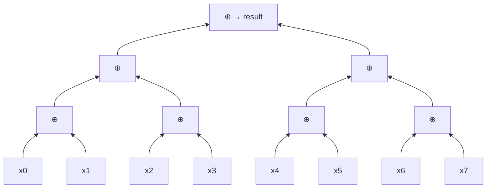
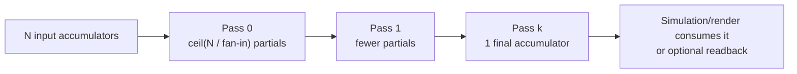
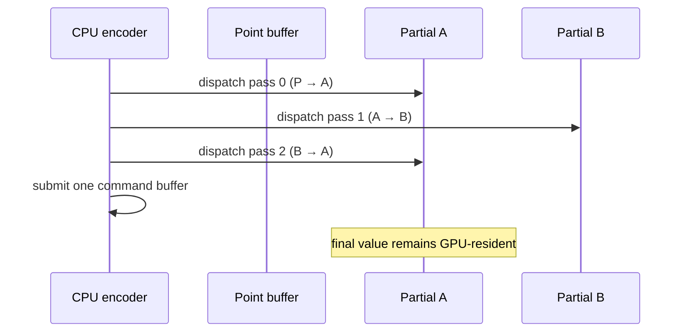

# Parallel reduction

Reduction is the pattern that turns many values into one value. It is how Cosmos can
turn millions of point positions into a global sum, a center of mass, a bounding box,
an energy total, or a maximum velocity without transferring the full dataset back to
the CPU.

The production-friendly WebGPU baseline is a **hierarchical, multi-pass tree**:

1. each invocation reads one or more input elements;
2. each workgroup combines its values in workgroup memory;
3. one partial result per workgroup is written to a storage buffer;
4. another dispatch reduces those partials;
5. the process repeats until one accumulator remains.

This is not just a workaround for missing floating-point atomics. It gives us bounded
contention, contiguous reads, predictable memory use, and an explicit numerical order.

## 1. The algebra behind the algorithm

A reduction needs three things:

- an **input value** for every element;
- an **associative combine operation** `⊕`, meaning `(a ⊕ b) ⊕ c = a ⊕ (b ⊕ c)` in
  the mathematical model;
- an **identity value** `e`, meaning `e ⊕ a = a ⊕ e = a`.

| Result | Per-point value | Combine | Identity |
| --- | --- | --- | --- |
| Point count | `1` | integer addition | `0` |
| Position sum | `(x, y)` | vector addition | `(0, 0)` |
| Weighted center | `(x·m, y·m, m)` | vector addition | `(0, 0, 0)` |
| Bounding box | `(min, max)` | component min/max | `(+∞, −∞)` |
| Maximum speed | `length(velocity)` | maximum | `−∞` or `0` |
| “All valid?” | boolean | logical AND | `true` |

Associativity lets us change parentheses and build a tree. Commutativity—`a ⊕ b =
b ⊕ a`—is useful but not required if the tree preserves input order. Matrix
multiplication is associative but not commutative, for example.

Real floating-point addition is only approximately associative. That complication is
important enough to get its own section below.

## 2. Sequential fold versus parallel tree

A CPU loop usually creates a dependency chain:

```text
((((x0 + x1) + x2) + x3) + ... + xn)
```

It performs `n − 1` combines and has a dependency depth of `O(n)`. A balanced tree
does the same `O(n)` total work but has `O(log n)` depth when enough processors are
available:



The two standard measures are:

- **work**: all operations performed, `O(n)`;
- **span** or critical-path depth: operations that must happen in sequence,
  `O(log n)` for the balanced tree.

On a finite GPU, every invocation first reduces several values locally. If `p`
invocations participate, a useful mental model is `O(n / p + log p)`.

## 3. Why one dispatch is not enough

Invocations in one workgroup can cooperate through workgroup memory and a barrier.
Different workgroups cannot perform a device-wide barrier inside a dispatch. Their
execution order is intentionally unspecified, and some workgroups may not even be
resident at the same time.

Therefore a workgroup must finish independently and write one partial result. Ending
the dispatch creates the boundary needed before a later dispatch reads those partials.



If a workgroup has `W` invocations and each invocation consumes `E` elements, the
nominal fan-in is `F = W × E`. The number of live accumulators evolves as:

```text
n(0) = input count
n(k + 1) = ceil(n(k) / F)
stop when n(k) = 1
```

With `W = 256` and `E = 4`, the nominal fan-in is 1,024:

| Input | Pass 0 | Pass 1 | Pass 2 |
| ---: | ---: | ---: | ---: |
| 1,000,000 | 977 | 1 | — |
| 10,000,000 | 9,766 | 10 | 1 |

Only the first pass is large. Later passes touch tiny buffers, which is why the
hierarchy scales well.

## 4. Inside one workgroup

The portable baseline uses a fixed workgroup size, sequential addressing, and a
stride-halving tree.

```wgsl
const WORKGROUP_SIZE: u32 = 256u;
const ELEMENTS_PER_INVOCATION: u32 = 4u;

var<workgroup> shared: array<Accumulator, WORKGROUP_SIZE>;

@compute @workgroup_size(WORKGROUP_SIZE)
fn reduce(
  @builtin(local_invocation_id) local_id: vec3u,
  @builtin(workgroup_id) group_id: vec3u,
) {
  let lane = local_id.x;
  let first = group_id.x * WORKGROUP_SIZE * ELEMENTS_PER_INVOCATION + lane;

  var local = identity();
  for (var item = 0u; item < ELEMENTS_PER_INVOCATION; item++) {
    let index = first + item * WORKGROUP_SIZE;
    if (index < uniforms.input_count) {
      local = combine(local, input[index]);
    }
  }

  shared[lane] = local;
  workgroupBarrier();

  var stride = WORKGROUP_SIZE / 2u;
  loop {
    if (lane < stride) {
      shared[lane] = combine(shared[lane], shared[lane + stride]);
    }
    workgroupBarrier(); // every invocation reaches every barrier
    if (stride == 1u) { break; }
    stride /= 2u;
  }

  if (lane == 0u) {
    output[group_id.x] = shared[0];
  }
}
```

Several details carry most of the correctness and performance:

1. **Contiguous lanes read contiguous addresses.** The `item * WORKGROUP_SIZE` offset
   lets adjacent invocations issue adjacent storage-buffer loads.
2. **Each invocation combines several values in registers first.** This increases
   useful work per workgroup without increasing shared-memory traffic.
3. **Out-of-range lanes contribute the identity.** No special power-of-two input size
   is required.
4. **All invocations reach every barrier.** A barrier inside control flow that only
   some invocations enter is invalid and can deadlock or fail validation.
5. **Only lane zero writes.** The workgroup produces exactly one partial and needs no
   cross-workgroup atomic operation.

The sample assumes a power-of-two `WORKGROUP_SIZE`. A general implementation can pad
to the next power of two, use an uneven-tree algorithm, or specialize pipelines for
selected sizes. Fixed sizes are simpler and easier to validate.

## 5. Buffers and command encoding

The implementation needs two small partial buffers, conventionally called A and B.
Pass 0 writes A, pass 1 reads A and writes B, pass 2 reads B and writes A, and so on.
The input point buffer itself is never overwritten.



The passes can be encoded into one command buffer and submitted together. WebGPU
orders commands in that submission and tracks the storage-buffer usage between
passes. No CPU wait is needed. Mapping a result buffer is a separate synchronization
boundary and should be reserved for tests, diagnostics, or UI values that truly need
to reach JavaScript.

The required scratch capacity is based on the first pass, not on all input elements:

```text
partialCapacity = ceil(inputCapacity / F)
scratchBytes ≈ 2 × partialCapacity × sizeof(Accumulator)
```

For 10 million inputs, fan-in 1,024, and a 16-byte accumulator, both ping-pong
buffers together use only about 305 KiB.

## 6. Why not one global atomic?

There are several implementation families, but they do not have equal portability or
behavior.

| Approach | Advantages | Problems | Cosmos role |
| --- | --- | --- | --- |
| Hierarchical workgroup tree | Portable, bounded contention, regular access, preserves rich accumulator structs | Multiple dispatches and scratch buffers | **Default** |
| One global integer atomic | Very simple; exact for in-range integers | Severe contention; only integer atomic types in core WGSL | Counters, flags, bounded fixed-point experiments |
| Per-workgroup tree + one atomic/workgroup | Far less contention than per-item atomics | Still needs an atomic representation; ordering varies | Optional integer fast path |
| Compare/exchange-emulated float atomic | Can implement float addition over integer bits | Retry storms, NaN corner cases, nondeterministic order, harder proof | Avoid as baseline |
| Raster blending | Natural in the existing WebGL renderer | Tied to render pipeline/attachments; precision and feature support vary | Legacy comparison, not compute architecture |
| CPU reduction after readback | Easy reference implementation | Transfers `O(n)` data and stalls the GPU/CPU pipeline | Tests only |

Core WGSL atomic objects are integer atomics, not portable `atomic<f32>`. Converting
floats to fixed-point integers is viable only when we can prove the scale, range, and
overflow behavior. It is not a general position-sum solution.

An optional **subgroup** fast path can first combine values inside hardware subgroups,
then combine subgroup totals in workgroup memory. This can reduce barriers and shared
traffic, but subgroup support and size are adapter-dependent. It should be a
capability-selected optimization behind the same result contract, not the only
implementation.

## 7. Performance model and tuning

Large reductions are normally memory-bandwidth-bound: the combine operation is cheap
relative to reading the input. Optimize bytes and access patterns before clever
arithmetic.

### Workgroup size

`256` is a good starting point, not a universal optimum. The WebGPU portable default
limit is 256 compute invocations per workgroup, but an adapter may expose larger
limits. Larger workgroups can reduce the number of partials, while also consuming more
workgroup memory and registers and potentially reducing occupancy. Benchmark 64, 128,
and 256 on representative adapters.

### Elements per invocation

Increasing `E` amortizes dispatch and barrier costs and lets an invocation accumulate
in registers. Too large a value increases register pressure and reduces parallelism.
Values such as 2, 4, or 8 make sensible benchmark candidates.

### Memory layout

Use compact, aligned accumulator records and contiguous reads. A structure-of-arrays
layout may save bandwidth when a reduction needs only one field; an array of aligned
accumulator structs is convenient between passes. The best choice depends on whether
the first pass reads the simulation’s native position/mass buffers directly.

### Measure GPU time, not only JavaScript time

`queue.submit()` is asynchronous. CPU duration around submission mostly measures
encoding and queueing. When the adapter exposes WebGPU’s optional `timestamp-query`
feature, timestamps around the compute work give a much better GPU-duration signal.
Otherwise, use carefully bounded completion waits in a benchmark mode, never in the
per-frame hot path.

Measure separately:

- pipeline/bind-group setup (once or when capacity changes);
- command encoding and submission;
- actual GPU duration;
- optional readback latency;
- end-to-end frame impact while rendering and simulation also run.

## 8. Floating-point accuracy and reproducibility

In real arithmetic, addition is associative. In `f32`, rounding after intermediate
operations means these may differ:

```text
(large + -large) + small  → small
large + (-large + small)  → often 0
```

A balanced pairwise tree often has lower accumulated error than a long sequential
sum because partials of similar magnitude meet earlier. It still does not promise the
same bits as the CPU loop or as a different tree.

For a fixed pipeline, fixed workgroup size, fixed input, and fixed tree, the algorithm
has a fixed *logical* order. That is useful for repeatability. It is not a universal
cross-device bitwise guarantee: WGSL permits implementation choices including fused
operations, reassociation in allowed circumstances, rounding behavior, and treatment
of subnormal values.

Choose the guarantee deliberately:

| Requirement | Practical technique |
| --- | --- |
| Stable visual center | Fixed tree with `f32`; compare using an error tolerance |
| Better ordinary accuracy | Pairwise tree plus compensated local sums (Kahan/Neumaier) |
| Wider dynamic range | Two-float (“double-single”) accumulator, at higher cost |
| Exact bounded counts | `u32` or `u64`-style multiword integer logic, with overflow policy |
| Cross-run/cross-device reproducible sum | Reproducible binned/superaccumulator algorithm; substantially more state and work |

WebGPU/WGSL does not provide a portable core `f64` shortcut. For Cosmos, a numerically
stable visual result with explicit tolerances is likely the right default; strict
reproducible summation should be a separate, opt-in requirement.

## 9. A critical Cosmos detail: count is not a float

The current experiment packs `(sumX, sumY, count, padding)` into `vec4f`. That is fine
up to 10 million points, but `f32` cannot represent every integer above `2²⁴ =
16,777,216`. Beyond that boundary, repeatedly adding counts can round and the final
division can use the wrong denominator.

A production accumulator should keep count as an integer:

```wgsl
struct CenterAccumulator {
  sum: vec2f,
  count: u32,
  _padding: u32,
}
```

For a weighted center of mass, replace or extend count with `totalMass: f32` and make
the policy for zero, negative, non-finite, or extremely large mass explicit. If count
can exceed `u32`, define chunking or a multiword count rather than silently wrapping.

The same discipline applies to invalid positions. Decide whether NaN/Infinity values
are rejected during ingest, skipped with a separate invalid counter, or deliberately
propagated. A reduction should not invent that semantic policy accidentally.

## 10. Correctness invariants

The implementation is correct when all of these remain true:

1. every valid input contributes exactly once;
2. every out-of-range load contributes exactly the identity;
3. no pass reads and writes overlapping accumulator ranges;
4. each workgroup writes exactly one partial;
5. all invocations encounter workgroup barriers in uniform control flow;
6. the next pass receives the exact output count of the previous pass;
7. the accumulator layout and alignment agree in TypeScript and WGSL;
8. overflow, NaN, Infinity, empty input, and zero total mass have specified behavior;
9. buffers are allocated for capacity, while dispatch and bounds use the live count;
10. the final buffer remains valid until all GPU consumers have finished with it.

Useful validation cases include `0`, `1`, `W − 1`, `W`, `W + 1`, non-power-of-two
sizes, one million, ten million, cancellation-heavy values, extreme magnitudes,
invalid data, repeated ticks, and multiple GPU adapters. Compare against a CPU
reference with absolute and relative tolerances, and check structural properties such
as `min ≤ value ≤ max` where applicable.

## 11. Recommended Cosmos primitive

The center of mass should be the first client of a reusable reduction engine, not the
only algorithm baked into it.

```text
GPUReductionPlan
├── fixed capacity and accumulator byte layout
├── input/output buffer views
├── specialized map + combine WGSL module
├── workgroup size and elements-per-invocation
├── preallocated ping-pong partial buffers
├── one pipeline/bind-group set per pass shape
└── encode(commandEncoder, liveCount) → final buffer view
```

WGSL does not have runtime generics, so “map” and “combine” should be shader
specializations generated or composed at pipeline creation—not JavaScript callbacks
inside a dispatch. The public contract can still be generic at the TypeScript level.

The final accumulator should stay GPU-resident. Force-center, rendering diagnostics,
or later compute passes can bind the one-record result directly. Readback is an
explicit optional method for tests and visible metrics.

Luma’s experimental `GPUReduction` may eventually provide part of this abstraction,
and `GPUCommandGraph` is a natural home for the fixed sequence of passes, declared
resource hazards, transient scratch reuse, and encode-every-tick behavior. Those APIs
are experimental and version-sensitive, so the first implementation should preserve
a small Cosmos-owned contract around them rather than leak their current shape through
the engine API.

## 12. Implementation path

1. **Make the current experiment structurally correct:** integer count, explicit
   accumulator layout, empty-input behavior, and tolerance-based CPU comparison.
2. **Extract a fixed-capacity reduction plan:** preallocate pipelines, bind groups, and
   ping-pong buffers; only the live count changes each tick.
3. **Keep the result on the GPU:** render and simulation consumers bind it directly;
   readback becomes a debug toggle.
4. **Benchmark the parameter matrix:** workgroup sizes 64/128/256 and 2/4/8 elements
   per invocation on integrated and discrete GPUs.
5. **Add optional capability paths:** subgroup-assisted workgroup reduction when
   available; retain the portable tree as the reference implementation.
6. **Evaluate luma integration:** wrap the stable Cosmos contract with
   `GPUReduction`/`GPUCommandGraph` only after the chosen luma v10 API is pinned.

## Sources and further reading

- [WebGPU specification](https://www.w3.org/TR/webgpu/) — dispatch, command ordering,
  limits, timestamp queries, and optional subgroup features.
- [WGSL specification](https://www.w3.org/TR/WGSL/) — barriers, uniformity analysis,
  atomic types, workgroup size, and floating-point behavior.
- [Guy Blelloch, *Prefix Sums and Their Applications*](https://www.cs.cmu.edu/~guyb/papers/Ble93.pdf)
  — the work/span model and tree formulation of scan and reduce.
- [Mark Harris, *Optimizing Parallel Reduction in CUDA*](https://developer.download.nvidia.cn/compute/cuda/1.1-Beta/x86_website/projects/reduction/doc/reduction.pdf)
  — the classic progression from divergent trees to sequential addressing and
  multi-element local accumulation. CUDA-specific syntax, broadly applicable ideas.
- [Ahrens, Demmel, Nguyen, *Algorithms for Efficient Reproducible Floating Point Summation*](https://people.eecs.berkeley.edu/~demmel/ma221_Fall23/J115_Efficient_Reproducible_Summation_TOMS_2020.pdf)
  — why parallel floating-point sums vary and how reproducible accumulators trade
  additional work and state for stronger guarantees.
- [luma.gl GPU Core](https://luma.gl/docs/api-reference/experimental/gpu-core) and
  [GPUCommandGraph](https://luma.gl/docs/api-reference/experimental/gpu-core/gpu-command-graph)
  — experimental reduction and reusable multi-pass command abstractions.
- [luma.gl optional WebGPU/WGSL features](https://luma.gl/docs/api-reference/webgpu/optional-features)
  — subgroup capability detection and reduction fast paths.
