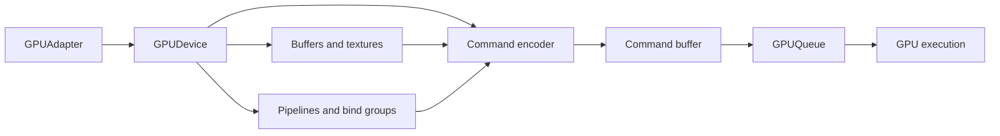
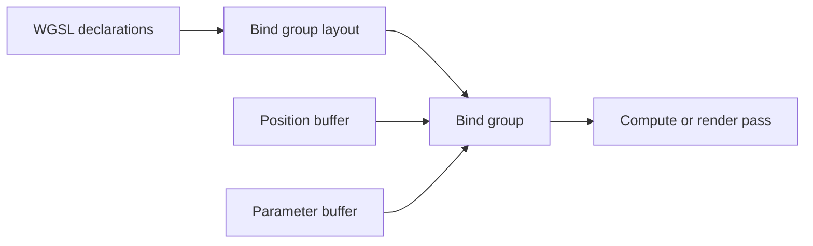
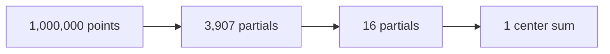

# WebGPU concepts and terms

WebGPU is an explicit GPU API. JavaScript describes resources and commands; the browser validates them and submits
finished command buffers to a GPU queue. Most objects are intentionally separated by role, which makes the API more
verbose than WebGL but also makes data flow and synchronization much easier to reason about.

This page uses **Cosmos meaning** callouts to connect general WebGPU terms to graph simulation and rendering.

## Device and API objects

### Adapter (`GPUAdapter`)

A description of a GPU implementation the browser can expose. It reports supported **features** and **limits** and is
used to request a device. An adapter is not where commands are created or submitted.

### Device (`GPUDevice`)

The logical connection to the GPU. It creates buffers, textures, shader modules, bind groups, pipelines and command
encoders. The device owns a queue and can be lost because of a driver reset, GPU switch or resource failure.

**Cosmos meaning:** a Cosmos graph should normally share one device with the host application instead of creating a
device per force or renderer.

### Queue (`GPUQueue`)

The ordered submission channel attached to a device. `queue.submit()` sends finished command buffers to the GPU.
`queue.writeBuffer()` and `queue.writeTexture()` are convenient CPU-to-GPU upload operations.

Submission order is preserved. Submission is asynchronous: returning from `submit()` does **not** mean the GPU has
finished the work.

### Canvas context (`GPUCanvasContext`)

Connects WebGPU rendering to an HTML canvas. `getCurrentTexture()` returns the presentation texture for the current
frame. The context is configured with the device, a texture format and an alpha mode.

### Feature

An optional capability, such as timestamp queries, that must be supported by the adapter and explicitly requested when
creating a device. Algorithms should have a fallback when a feature is optional.

### Limit

A numeric device boundary such as maximum storage-buffer binding size, workgroups per dispatch, bindings per group or
workgroup storage size. Portable code checks limits before allocating or dispatching instead of assuming desktop-GPU
values.

## Resources and views

### Resource

GPU-owned memory that commands can read or write. The main resource types are buffers and textures. WebGPU requires
every resource to declare its allowed **usage flags** when it is created.

### Buffer (`GPUBuffer`)

A linear byte allocation. The same buffer can hold positions, velocities, masses, link indices, partial sums, uniforms
or copy results. A shader interprets bytes according to its WGSL type and binding declaration.

Common usage flags:

| Usage | Purpose |
| --- | --- |
| `STORAGE` | Large shader-readable or shader-writable arrays |
| `UNIFORM` | Small read-only parameter blocks |
| `VERTEX` / `INDEX` | Fixed-function render inputs |
| `COPY_SRC` / `COPY_DST` | Source or destination of copy commands |
| `MAP_READ` / `MAP_WRITE` | CPU-visible mapped memory |
| `INDIRECT` | Arguments consumed by indirect draw or dispatch |

**Cosmos meaning:** positions and simulation state naturally become storage buffers. They can be written by compute and
read directly by rendering without a CPU round trip.

### Texture (`GPUTexture`)

A one-, two- or three-dimensional image allocation with a texel format. Textures are suited to images, render targets,
depth buffers and spatial data that benefits from texture addressing or sampling. WebGPU does not require simulation
arrays to be encoded as square textures as WebGL often does.

### Texture view (`GPUTextureView`)

A description of how a texture is used: which mip levels, array layers, aspect and view dimension are visible. Bind
groups and render attachments bind a view rather than the texture object itself.

This is the core **resource/view model**: the texture owns memory; one or more views expose compatible windows onto it.

### Sampler (`GPUSampler`)

Describes filtering and addressing for sampled textures. It contains behavior—nearest/linear filtering, clamp/repeat—not
image data.

### Uniform buffer

A buffer used for small, frequently reused read-only parameters such as point count, time step or camera matrix. Uniform
layouts have alignment rules; padding fields are often needed to match WGSL structure layout.

### Storage buffer

A buffer exposed to a shader as a large array or structure. It may be read-only or read-write. Storage buffers are the
main memory primitive for general compute in Cosmos.

### Mapping and staging buffer

Mapping makes a buffer range visible to JavaScript as an `ArrayBuffer`. A staging buffer is a CPU-visible intermediate
used to upload or read data when the working buffer itself is GPU-only.

Reading GPU results usually means copying them into a `MAP_READ | COPY_DST` buffer, waiting for completion, mapping it,
copying the values, and unmapping it.

### Readback

Any GPU-to-CPU transfer. Readback creates a synchronization boundary because JavaScript cannot inspect the result until
the GPU reaches the copy. It should be explicit and infrequent on the simulation hot path.

## Bindings and pipelines

### Binding

A numbered shader-visible slot for a buffer, texture, texture view, sampler or external texture. WGSL identifies it with
`@group(n) @binding(m)`.

### Bind group layout (`GPUBindGroupLayout`)

The contract for one group of bindings: slot numbers, shader visibility, resource kinds and access modes. It describes
what may be bound, not the concrete resources.

### Bind group (`GPUBindGroup`)

An immutable set of concrete resources matching a bind group layout. Bind groups are designed to be prepared ahead of
time and reused across many dispatches or draws.

### Pipeline layout (`GPUPipelineLayout`)

The ordered collection of bind group layouts used by a pipeline. `layout: "auto"` asks WebGPU to derive it from the
shader, which is convenient for experiments but makes sharing bind groups between pipelines more restrictive.

### Compute pipeline (`GPUComputePipeline`)

A compiled compute entry point plus its binding layout. It has no vertex assembly, rasterization or framebuffer state.

### Render pipeline (`GPURenderPipeline`)

A compiled vertex/fragment program together with fixed render state: vertex layouts, primitive topology, color formats,
blending, depth/stencil rules and multisampling.

### Pipeline cache

An application-level practice of reusing compiled pipelines rather than creating them every frame. Pipeline creation can
involve validation and shader compilation and belongs in setup or controlled cache misses.

## Commands and passes

### Command encoder (`GPUCommandEncoder`)

A CPU-side recorder for GPU work. It records render passes, compute passes and copies. `finish()` turns the recorded work
into an immutable command buffer.

### Command buffer (`GPUCommandBuffer`)

A finished sequence of GPU commands ready for queue submission. It cannot be edited or submitted more than once.

### Compute pass (`GPUComputePassEncoder`)

A sequence of compute pipeline selections, bind group changes and dispatches. Multiple dependent dispatches can be
recorded in one compute pass; commands observe WebGPU’s defined usage ordering.

### Render pass (`GPURenderPassEncoder`)

A sequence of draw commands targeting declared color and optional depth/stencil attachments. Attachment `loadOp` and
`storeOp` state whether previous contents are preserved, cleared and retained.

### Copy command

A direct transfer between compatible buffers or textures. Copies do not need a shader and are the normal way to move a
result into a readback buffer.

### Dispatch

`dispatchWorkgroups(x, y, z)` starts a grid of compute workgroups. It counts **workgroups**, not individual shader
invocations. With `@workgroup_size(256)`, dispatching 100 workgroups launches 25,600 invocations.

### Draw

A render command that asks the vertex stage to produce primitives. `draw(vertexCount, instanceCount)` can read storage
buffers using `vertex_index`, so a separate vertex buffer is not always required.

### Primitive topology

The rule used to assemble vertices into points, lines or triangles: for example `point-list`, `line-list` or
`triangle-list`. WebGPU points are deliberately minimal; portable circles and variable-size markers are usually emitted
as instanced quads made from triangles.

### Indirect dispatch or draw

A command whose counts are read from a GPU buffer. This lets one GPU pass decide how much work a later pass performs
without CPU readback. It is useful for compaction, adaptive graph workloads and GPU-driven rendering.

## WGSL and the compute execution model

### WGSL

WebGPU Shading Language, the portable shader language required by WebGPU. It has explicit address spaces, binding
annotations, entry points and stricter validation than GLSL.

### Shader module (`GPUShaderModule`)

A container for WGSL source parsed by the device. Pipelines select one or more named entry points from a module.

### Compute shader

A shader stage launched explicitly as a grid of workgroups. It reads and writes buffers or storage textures without
rasterizing geometry. Compute shaders are the WebGPU replacement for many full-screen fragment passes currently used by
Cosmos simulation.

### Vertex shader

The render stage that produces clip-space vertex positions and optional values for interpolation. It can consume vertex
buffers, built-in indices, uniforms and read-only storage buffers.

### Fragment shader

The render stage that computes color or other attachment outputs for rasterized fragments. A fragment shader runs only
after primitives have been assembled and rasterized; unlike a compute shader, its invocation grid is not dispatched
directly by the application.

### Entry point

A shader function marked `@compute`, `@vertex` or `@fragment`. One module can contain several entry points.

### Invocation

One execution of a shader entry point. Compute invocations are organized into workgroups; vertex and fragment
invocations are produced by the rendering pipeline.

### Workgroup

A fixed-size group of compute invocations that can cooperate through workgroup memory, barriers and workgroup-level
built-ins. Workgroup size is declared in WGSL, for example `@workgroup_size(256)`.

### Global, local and workgroup IDs

| Built-in | Meaning |
| --- | --- |
| `global_invocation_id` | Invocation coordinate across the entire dispatch |
| `local_invocation_id` | Invocation coordinate inside its workgroup |
| `workgroup_id` | Workgroup coordinate inside the dispatch grid |
| `num_workgroups` | Total dispatched workgroup grid |

### Address space

Where a WGSL variable lives and how it may be accessed: `function`, `private`, `workgroup`, `uniform` or `storage`.
Address space affects lifetime, visibility and synchronization rules.

### Workgroup memory

Fast scratch memory shared by invocations in one workgroup, declared with `var<workgroup>`. It is not visible to other
workgroups and does not persist after the dispatch.

### Barrier

`workgroupBarrier()` makes workgroup-memory operations performed before the barrier visible to participating invocations
after it. Every invocation in the workgroup must reach barriers in compatible control flow or the program is invalid.

### Atomic operation

An indivisible read-modify-write on an atomic integer. Atomics prevent lost updates when many invocations target the same
location, but high contention can serialize execution. Core WGSL does not provide portable atomic floating-point add.

### Race condition

Two or more invocations access the same memory concurrently and at least one writes without a valid synchronization
strategy. Results may vary between devices or runs. “It works on my GPU” is not evidence that a race is valid.

## Synchronization and lifetime

### GPU-resident data

Data that stays in GPU resources across frames or simulation ticks. Compute updates it and rendering consumes it directly.
This is the central performance model for the WebGPU version of Cosmos.

### CPU/GPU synchronization boundary

A point where CPU code must wait for GPU progress, such as `mapAsync()` for a result or `queue.onSubmittedWorkDone()`.
Submitting commands alone is not such a wait.

### Ping-pong buffers

Two buffers that alternate input and output roles between passes. Ping-ponging avoids reading and writing the same logical
array in unsafe ways and is common in reductions and iterative simulation.

### Double buffering

Keeping separate “current” and “next” states so a pass reads a stable snapshot while producing the next one. The term is
similar to ping-ponging; double buffering usually emphasizes state across iterations or frames.

### Resource hazard

A conflicting ordering of reads and writes to a resource. WebGPU validates many usage hazards at pass boundaries and
defines synchronization for ordered commands, but the algorithm must still avoid races inside a dispatch.

### Device loss

The logical device becomes unusable. Robust applications observe `device.lost`, release dependent state and either show
a useful error or rebuild on a newly requested device.

## Parallel primitives used by Cosmos

### Reduction

Combines many values into fewer values using an associative operation: sum, minimum, maximum or bounding box. A large
reduction writes one partial per workgroup, then recursively reduces partials until one result remains.

### Scan / prefix sum

Produces all running totals. For input `[3, 1, 4]`, an exclusive scan is `[0, 3, 4]` and an inclusive scan is
`[3, 4, 8]`. Scans turn per-item counts or flags into stable output offsets and are a building block for compaction,
grid construction and CSR construction.

### Scatter

Each invocation writes its value to a computed destination index. A scatter is safe only when destinations are unique or
collisions are resolved with atomics or another pass.

### Gather

Each invocation reads one or more values from computed source indices and writes its own unique output. Gather patterns
are generally easier to make race-free than scatters.

### Compaction

Filters active items into a dense array. A typical GPU compaction marks items, scans the marks to obtain destinations and
scatters active items into those destinations.

### Grid / spatial grid

A partition of 2D or 3D space into cells. Points are assigned cell IDs, grouped by cell and queried through nearby cells.
For many-body forces this replaces an all-pairs search with a bounded neighborhood search when the approximation allows it.

### Grid primitives

The reusable GPU operations that build and query a grid: compute cell IDs, count occupants, scan counts into offsets,
scatter point IDs into cell storage, and iterate a cell’s `[start, end)` range.

### CSR (compressed sparse row)

A compact representation of variable-length adjacency lists using two arrays:

- `offsets`: where each node’s neighbor range begins; length is `nodeCount + 1`.
- `indices`: all neighbor IDs concatenated into one array.

Node `i` owns `indices[offsets[i] ... offsets[i + 1])`. CSR is efficient on the GPU because it uses contiguous typed
buffers and avoids JavaScript objects or pointers.

### Topology builder

A pipeline that converts edge pairs into a GPU-friendly adjacency representation such as CSR. It commonly counts each
node’s degree, scans degrees into offsets, then scatters edge endpoints into the final index array.

### GPU command graph

A reusable description of passes and their resource dependencies. A graph can determine execution order, resource
lifetimes, transient-buffer reuse and where synchronization is required. It is an orchestration abstraction above raw
WebGPU command encoders—not a WebGPU standard object.

## WebGL-to-WebGPU translation

| WebGL / current Cosmos | WebGPU direction |
| --- | --- |
| Data packed into float textures | Typed arrays in storage buffers |
| Full-screen fragment pass | Compute dispatch |
| Additive blending as accumulation | Multi-pass reduction, scan/scatter or integer atomics |
| Framebuffer and attached textures | Render pass attachments and texture views |
| Uniform setters and texture units | Uniform buffers and bind groups |
| Implicit mutable GL state | Immutable pipelines plus explicit pass commands |
| GLSL shader | WGSL shader module and entry point |
| `readPixels` | Copy to staging buffer, then `mapAsync` |

The important architectural change is not only GLSL → WGSL. It is moving from render-pass-shaped computation and
implicit global state to explicit resources, compute primitives and GPU-resident data flow.
