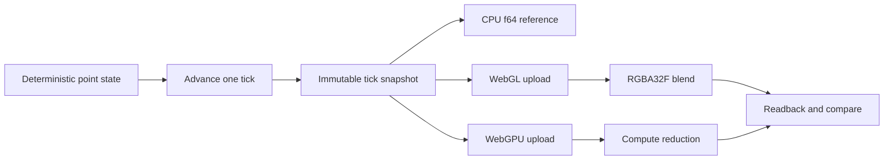
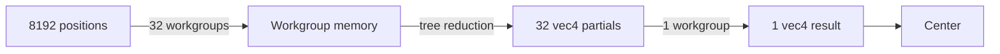

# Algorithm

## Shared tick



The coordinator never advances between backend executions. Each backend therefore observes the same `Float32Array`
contents for a given tick.

## WebGL accumulation

WebGL has no compute shaders. Cosmos can nevertheless perform a global sum by drawing every point into the same
one-pixel floating-point framebuffer.

The vertex shader passes the source position to the fragment shader. Every fragment writes:

```glsl
contribution = vec4(pointPosition, 1.0, 0.0);
```

With `FUNC_ADD` and `ONE, ONE` blending, fixed-function blending repeatedly performs:

```text
destination = source + destination
```

The final pixel contains `(sumX, sumY, count, 0)`. This path requires both `EXT_color_buffer_float` and
`EXT_float_blend`.

## WebGPU reduction

WebGPU uses two compute dispatches with workgroups of 256 invocations.



Each invocation loads one position as `(x, y, 1, 0)`. Values are reduced in workgroup memory using a binary tree:

```text
256 values
128 additions
 64 additions
 32 additions
 16 additions
  8 additions
  4 additions
  2 additions
  1 addition
```

Invocation zero writes the workgroup result to the partial buffer. A second workgroup applies the same reduction to
those partials.

The current two-stage implementation supports at most `256 × 256 = 65,536` points. A general implementation needs
recursive dispatches or a command graph that repeats reduction passes until one value remains.
