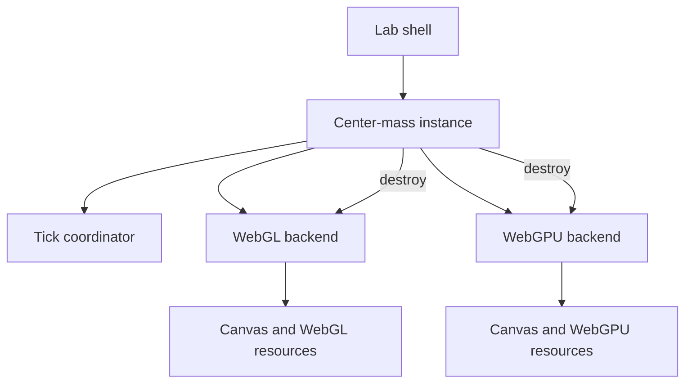

# Implementation

## Resource ownership

The experiment owns one WebGL device and one WebGPU device. Navigating away calls `destroy()` on the experiment, which
stops its timer and destroys every backend-owned GPU resource.

The lab shell knows only how to create and destroy an experiment. Controls, point state and backend comparison remain
inside the experiment package.

## luma.gl boundary

Both devices are created through luma.gl v10 adapters. The experiment then accesses the backend handle deliberately:

- `WebGLDevice.handle` gives the underlying `WebGL2RenderingContext`.
- `WebGPUDevice.handle` gives the underlying `GPUDevice`.

This keeps the compared algorithms visible and avoids hiding either path behind a higher-level helper. Future
experiments can instead test the portable luma resource and command APIs directly.

## Buffers

The WebGPU path allocates:

| Resource | Contents | Usage |
| --- | --- | --- |
| Position buffer | `8192 × vec2f` | storage, vertex, copy destination |
| Partial buffer | `32 × vec4f` | storage |
| Result buffer | `1 × vec4f` | storage, copy source |
| Readback buffer | `1 × vec4f` | map read, copy destination |
| Parameter buffers | counts and padding | uniform, copy destination |
| Center uniforms | center and pixel size | uniform, copy destination |

The position buffer is shared by compute and point rendering within the WebGPU backend. No CPU-side repacking is
required between those operations.

## Shaders

GLSL and WGSL are stored as separate files and imported through Vite's `?raw` query. This makes shader differences
reviewable while keeping the runtime API a plain string.

## Experiment discovery

The lab discovers `src/experiments/*/experiment.ts` through Vite `import.meta.glob`. Each manifest remains lightweight;
the actual demo and documentation pages are loaded only when selected.
