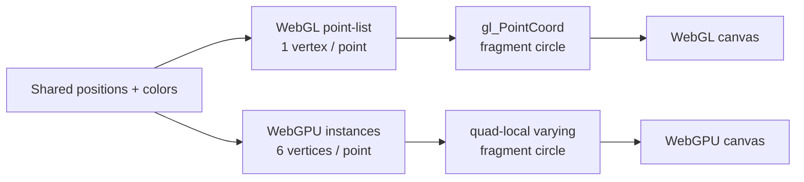

# Circle point rendering

This experiment isolates the first rendering migration question: how should Cosmos draw a
large set of screen-space circles when moving from WebGL 2 to WebGPU?

Both panels use the same deterministic position and color arrays, the same canvas dimensions,
the same diameter in CSS pixels, one draw call and the same fragment-level circle coverage.
Only the primitive expansion changes.

| | Cosmos WebGL path | WebGPU path |
| --- | --- | --- |
| Primitive | `point-list` | instanced `triangle-list` |
| Submitted geometry | one vertex per point | six vertices per point |
| Point position | vertex attribute | storage buffer indexed by `instance_index` |
| Sprite footprint | `gl_PointSize` | vertex shader expands a quad in clip space |
| Local circle coordinate | `gl_PointCoord` | varying emitted by the vertex shader |
| Edge | fragment-shader distance + `fwidth` | same mathematical coverage rule |

## Why the geometry must change

The current Cosmos point renderer relies on the WebGL point-sprite pipeline. The vertex shader
sets `gl_PointSize`; rasterization supplies `gl_PointCoord` to every covered fragment. This is
compact—one submitted vertex becomes a square sprite that the fragment shader cuts into a circle.

WebGPU's portable `point-list` primitive produces a one-pixel point and has no equivalent
programmable point size or `gl_PointCoord`. A wide marker therefore needs explicit geometry. The
standard approach is an instanced quad: the application submits six fixed corner vertices and the
vertex shader places that quad around every point.

This is the baseline, not yet the complete Cosmos renderer. It deliberately leaves shapes,
images, strokes, picking, render order, greyout, transitions and occlusion optimization for later
experiments.
