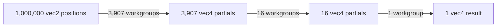
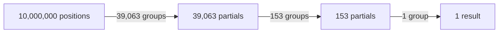

# Dynamic reduction hierarchy

Every workgroup reduces at most 256 input records into one `vec4f` partial:

```text
(x, y, 1, 0) → (sumX, sumY, count, 0)
```

The host repeatedly calculates:

```text
outputCount = ceil(inputCount / 256)
```

until `outputCount` reaches one.

## One million points



## Ten million points



Only the first pass reads `vec2f` positions. Later passes read and write `vec4f` partials. Two buffers alternate roles
between levels, so the allocation is based on the largest partial level rather than the sum of all levels.

## Workgroup reduction

Each workgroup loads one value per invocation into 4 KB of workgroup memory. A binary tree then performs eight
synchronized steps: `256 → 128 → 64 → 32 → 16 → 8 → 4 → 2 → 1`.

The hierarchy is built from the selected count at runtime, so non-power-of-two counts are padded with zero contributions
inside the shader.
