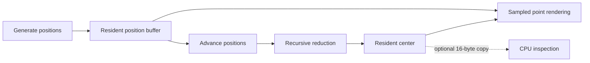

# Scalable reduction

The first center-mass experiment intentionally uses a fixed two-level reduction. That makes the algorithm easy to
compare with WebGL, but limits it to 65,536 points. This experiment removes that restriction by generating reduction
levels until only one value remains.

## Presets

| Points | Position storage | Reduction hierarchy |
| ---: | ---: | --- |
| 8,192 | 64 KB | `8,192 → 32 → 1` |
| 65,536 | 512 KB | `65,536 → 256 → 1` |
| 1,000,000 | 7.6 MB | `1,000,000 → 3,907 → 16 → 1` |
| 10,000,000 | 76.3 MB | `10,000,000 → 39,063 → 153 → 1` |

## GPU-resident flow

The point array is never uploaded from JavaScript. Compute shaders initialize and advance it. The same storage buffer
feeds reduction and sampled rendering, while the final center buffer feeds the red center marker directly.

Readback is optional. With readback disabled, no center value crosses back to JavaScript during a tick.
