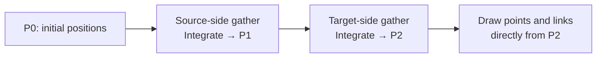

This experiment ports the **Cosmos spring contract** to WebGPU compute. The WebGL baseline runs the
production `ForceLink` GLSL and position-integration shader through luma `Model`, with separate
per-direction loop bounds matching Cosmos. WebGPU runs a WGSL translation through luma
`Kernel`, then draws points and straight links from the same storage buffers through `RenderKernel`.

It is an isolated link-only simulation, not the full Cosmos engine. Alpha is fixed; gravity, center,
many-body, collision resolution, transitions and interaction are outside this experiment.

## Why two directional passes?

Cosmos groups links by source and by target. The source-side pass is called `INCOMING` internally;
the target-side pass is called `OUTGOING`. Both retain original input order within each point's list.

Each point starts its directional displacement at zero. For each adjacent link, the spring sees
`otherPosition − (selfPosition + accumulatedDisplacement)`. It then adds another displacement.
This is **order-dependent**. A parallel reduction of independent edge forces, or computing both
directions from P0, would change Cosmos behavior.

For a pair initially at −0.6 and +0.6, rest length 0.2, unit spring/alpha/friction and equal degree:
the source moves by +0.5 to −0.1. The target then sees that updated source and moves by −0.25 to +0.35.
A simultaneous symmetric update would give a different result.

## Weights, bias and rest length

For each endpoint, degree counts **both directions**, including duplicates and both ends of self-loops.

- Bias is `otherDegree / (selfDegree + otherDegree)`.
- A finite nonnegative supplied weight is square-rooted. Zero disables that link's pull.
- A missing, negative or non-finite weight falls back to `1 / max(minDegree, 1)`, then is square-rooted.
- Rest length is `distance × mix(variationLow, variationHigh, randomSample)`.
- When collision is enabled, rest length is at least the sum of the two padded radii. This demo tests
  that floor; it does not run collision resolution.

Each direction has its own deterministic random sample, uploaded identically to both backends. This
matches the production shader's inputs without requiring its stateful random generator to make the same
sequence of calls during construction. It is not a reproduction of an arbitrary production random seed.

The length denominator is floored at `restLength × 0.99`, as in Cosmos. The demo's positive rest lengths
keep coincident pairs finite. Zero-rest coincident behavior is not a portability guarantee.

## Integration and absence

A directional spring produces a displacement, not persistent momentum. Integration applies friction,
keeps pinned and absent points unchanged, drops non-finite displacements and bounds oversized steps.
The next direction consumes the integrated positions.

Links to an absent neighbor are skipped. Invalid endpoint indices never enter CSR. Absent endpoints
still contribute to topology degrees, matching the distinction between graph connectivity and current
presence. The demo uses finite hidden coordinates for absent points; NaN-based ingest and transitions
remain engine integration work.

Open the [live comparison](#/weighted-links), [CSR implementation](#/weighted-links/docs/implementation)
and [validation guide](#/weighted-links/docs/results).
