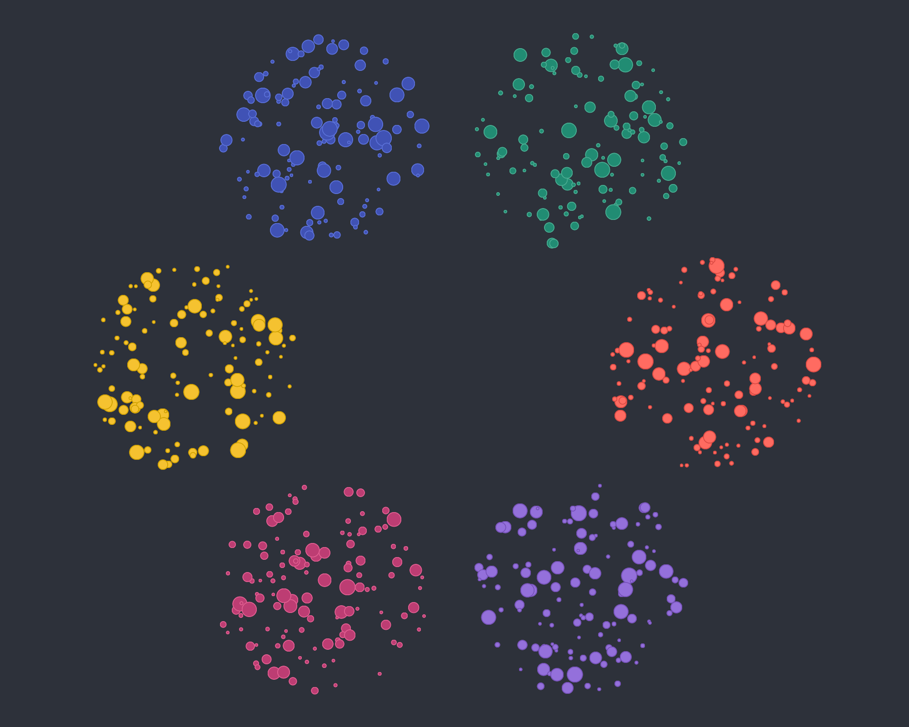
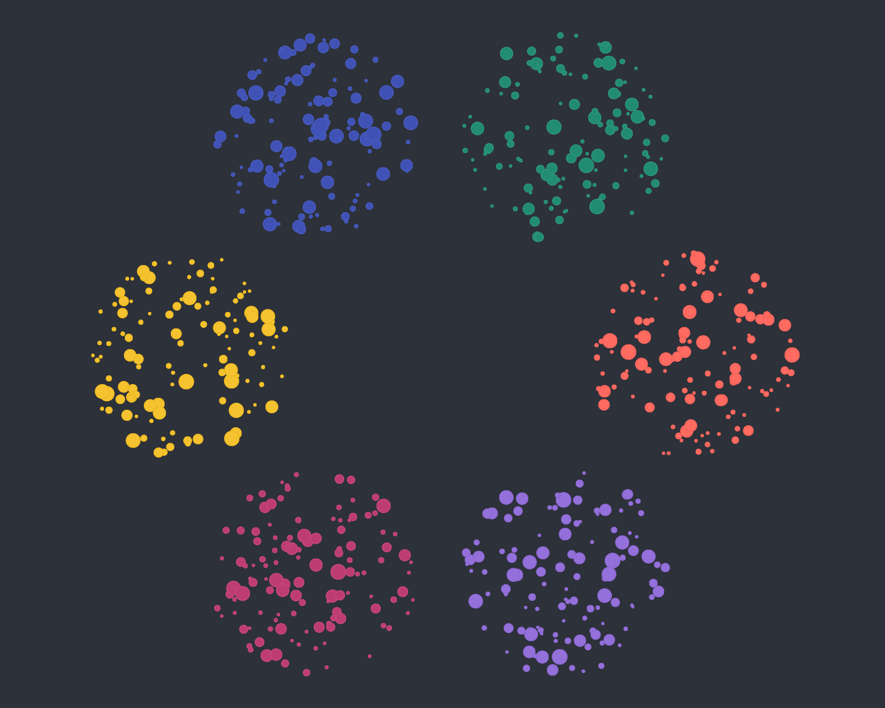

# Softer derived point strokes

**Date:** 2026-11-04
**PR:** [#293](https://github.com/cosmosgl/graph/pull/293)

**Why:** Lower the default derived stroke contrast from `0.1` to `0.03` for a subtler
edge around each point. The same OKLab lightness step applies to `auto`, `darken` and
`lighten`; explicit stroke colors keep their existing behavior.

The configuration docs and both stroke demos use the new value. These captures use
the same seeded overlap scene with a 1 px stroke and selection rings disabled:

| Before (`0.1`) | After (`0.03`) |
| --- | --- |
|  |  |
